# Popcorn Palace

[](https://github.com/antoniosifov/popcorn-palace/actions/workflows/ci.yml)

**It is running: [popcorn.antoniosifov.com](https://popcorn.antoniosifov.com).** Book a seat (payments are a sandbox, a ticket really is emailed), then look at what the booking did: [the API](https://api.popcorn.antoniosifov.com), [the dashboard](https://grafana.popcorn.antoniosifov.com) and [the traces](https://traces.popcorn.antoniosifov.com).

A cinema's ticketing product: see what is in cinemas now, choose seats on a seat map that changes as other people book, pay, and get the tickets by email. A web client, a booking API and a notifications service, with PostgreSQL, Redis and Kafka behind them, started by one command.

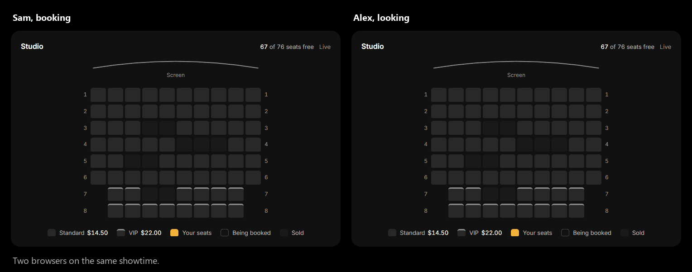

It is built to keep its promises when requests race each other: a seat is sold once, a customer is charged once, and a ticket email is sent if and only if the booking exists.

## What it looks like


| The week's programme | A film |
| --- | --- |
| 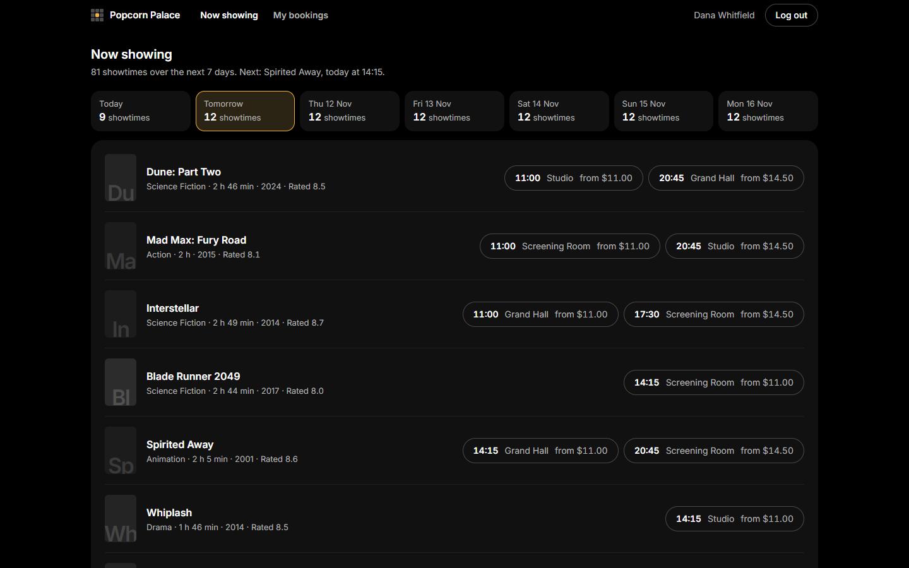 | 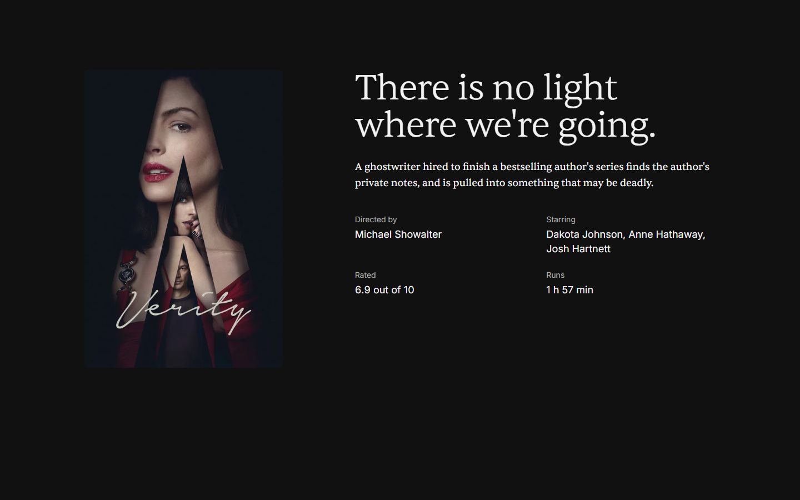 |
| **Choosing seats** | **Paying, here with a declined card** |
| 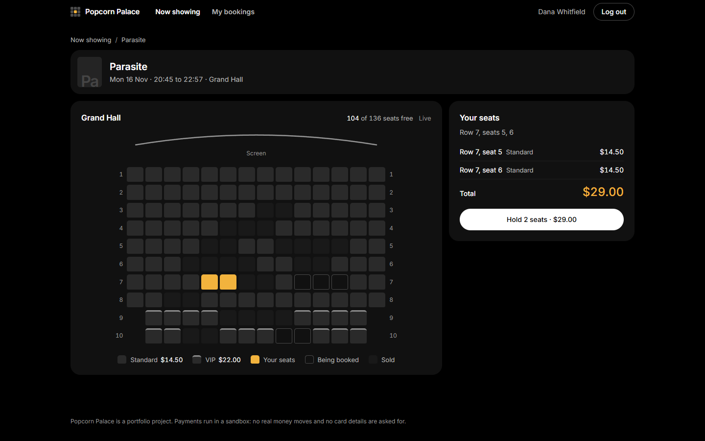 | 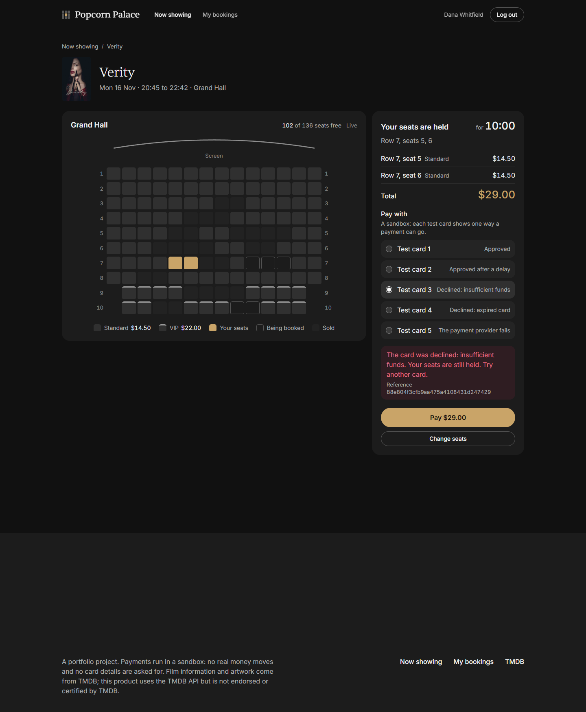 |

The ticket, once the payment went through:

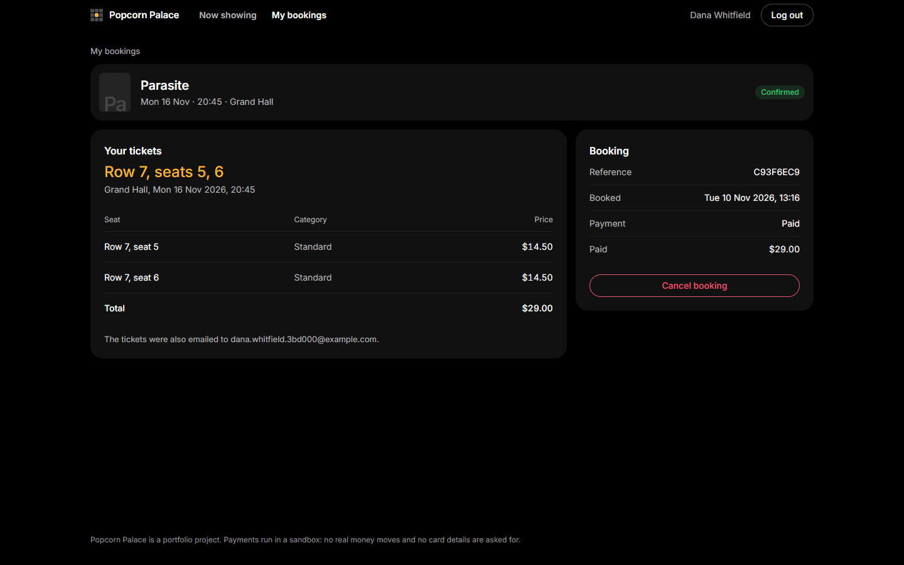

<p align="center">
  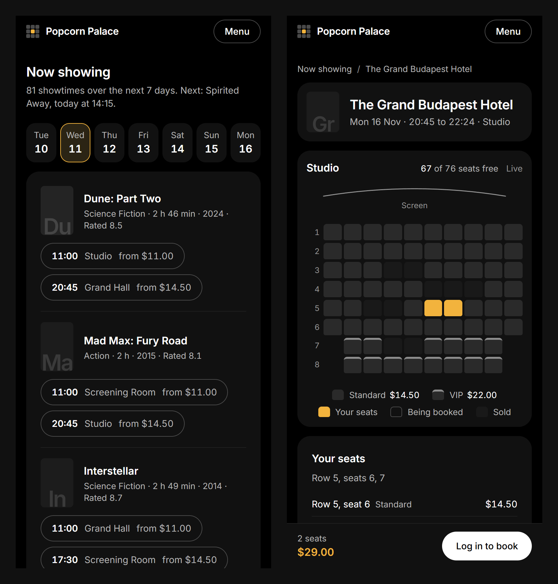
</p>

The cinema has a back office too. A hall is designed as blocks of rows and drawn while it is typed:

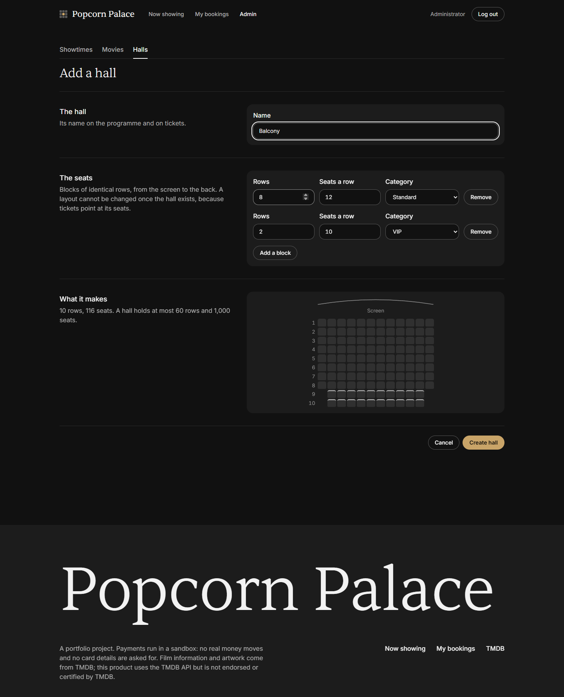

## Run it

Requirement: Docker (Docker Desktop on Windows/macOS).

```sh
docker compose up --build
```

Then open http://localhost:3000.

The stack starts with a demo programme (three halls, eight movies, a week of showtimes that rolls forward day by day), so there is something to book right away:

1. Create an account, pick a showtime and choose seats. Open the same showtime in a second window to watch the seats change there as you hold and buy them.
2. Pay with one of the test cards. The payment provider is a sandbox: no real money moves, no card details are asked for, and each test card shows one way a payment can go.
3. Read the ticket email in Mailpit at http://localhost:8025. Nothing reaches real mailboxes.

To manage movies, halls and showtimes, log in as the development administrator (`admin@popcorn.local` / `admin-dev-password`) and open **Admin**.

### Films that are in cinemas now

Out of the box the programme is made of eight built-in movies with drawn title cards. Give the stack a [TMDB](https://www.themoviedb.org) API key and it shows what is in cinemas now instead, with posters, stills, trailers, descriptions and cast, and keeps doing so: the list is read again twice a day, new releases join the programme and films that left cinemas leave it.

```sh
cp .env.example .env        # then set TMDB_API_KEY=... (free: themoviedb.org, Settings, API)
docker compose up --build
```

The key stays on the API server: it is never sent to a browser, logged or traced. `TMDB_REGION` (default `US`) chooses whose cinemas. [How the import works](backend/README.md#films-in-cinemas-now).

Days that already have showtimes keep them, so on a stack that was started without a key the current films appear as the week rolls forward. `docker compose down -v` before starting gives a fresh programme at once (and removes the accounts and bookings made so far).

### Where things are

| What | Where |
| --- | --- |
| The web client | http://localhost:3000 |
| The API, with interactive documentation | http://localhost:8080/swagger-ui.html |
| Emails the stack sent | http://localhost:8025 |
| Dashboard (Grafana; viewing needs no login) | http://localhost:3001 |
| Traces (Jaeger) | http://localhost:16686 |
| Metrics (Prometheus) | http://localhost:9090 |

If one of the ports (3000, 8080, 5432, 6379, 29092, 8025, 1025, 3001, 16686, 9090) is taken, copy `.env.example` to `.env` and change it. The same file sets the cinema's time zone (`CINEMA_TIME_ZONE`) and switches the demo programme off (`DEMO_DATA=false`).

## How it is built

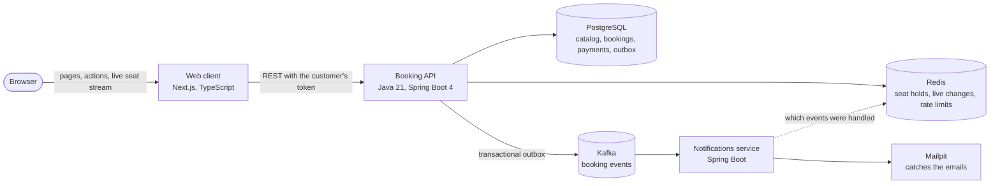

A booking from the click to the email:

1. **Hold.** The customer picks seats and the API reserves them in Redis for ten minutes with one atomic script: all of the seats or none. Every browser watching that showtime sees them become "being booked".
2. **Pay.** The payment is recorded before the provider is called, under an idempotency key, so a retry is answered from the record instead of charging again.
3. **Book.** The booking, the payment's success and an event in the outbox table are saved in one database transaction. A unique index on the seats of a showtime is the last word on who got them.
4. **Tell.** A relay sends the outbox to Kafka. The notifications service turns the event into a ticket email and remembers which events it has handled, because Kafka may deliver one twice.

## Engineering worth a look

The parts that took thought, and where each is explained and tested.

| Problem | What was done | Read more |
| --- | --- | --- |
| Two people want the same seat | Holds in Redis taken by an atomic Lua script, bookings guarded by a partial unique index in PostgreSQL. A test has 50 customers grab the same seats at once and exactly one of them gets them | [Checkout](backend/README.md#checkout-holding-seats-then-booking-them) |
| A payment is retried, or the answer is lost | Idempotency keys, the payment recorded before the charge, a refund when the booking cannot be saved, and a job that settles what was left unfinished | [Paying](backend/README.md#paying-charging-exactly-once) |
| The email must match the database | A transactional outbox: the event is written in the booking's transaction and published afterwards, at least once; the consumer drops duplicates | [Events](backend/README.md#events-the-transactional-outbox) |
| A seat map that is live on several instances | Changes fan out through Redis pub/sub to server-sent event streams; an expired hold is announced by Redis itself | [Live seat map](backend/README.md#live-seat-map-1) |
| The browser misses what happened before it subscribed | Subscribe first, then load the map again; one reducer handles events that overtake answers | [Seat map and checkout](frontend/README.md#the-live-seat-map-and-the-checkout) |
| A catalogue that keeps itself current | An import from TMDB that updates by the source's id, changes nothing when the source is down, takes films that left cinemas off the programme without touching their bookings, and keeps its key out of logs and traces | [Films in cinemas now](backend/README.md#films-in-cinemas-now) |
| Overlapping showtimes in one hall | An exclusion constraint in PostgreSQL, so the rule holds under concurrency, with a friendly check in front of it | [Overlapping showtimes](backend/README.md#overlapping-showtimes) |
| Keeping the token away from scripts | The browser talks to the web client only; the token lives in an `HttpOnly` cookie and every call to the API is made by the server | [How it fits together](frontend/README.md#how-it-fits-together) |
| One request across two services and a queue | A trace that survives the outbox: the row stores the request's trace context and the relay continues it | [Traces](backend/README.md#traces) |
| A cinema has one clock | Showtimes are stored as instants and shown and entered on the cinema's clock, including the nights the clocks change | [Time](frontend/README.md#time) |
| The same stack on a laptop and on a server | One compose file with a production layer over it: images tagged by commit, nothing reachable but the web server, secrets without defaults, and a release that is one script run by a key that can do nothing else | [Running it on a server](deploy/README.md) |
| A secret that has to travel through an event | A password reset link goes out the way tickets do, through the outbox and Kafka, but is kept in neither: only its hash is stored, the outbox row is deleted on delivery, the topic keeps an hour, and a failed event is dropped instead of parked. The new password ends the sessions that were open | [A forgotten password](backend/README.md#a-forgotten-password) |
| Somebody registers with your email before you do | Registration asks for no proof of the email, so an account can be opened in somebody else's name. When the owner later signs in with Google, the account is theirs, and a password set while the email was unproven does not survive it. The Google ID token itself is checked in full, audience included | [Signing in with Google](backend/README.md#signing-in-with-google) |
| Rules that hold when the code is wrong | Constraints in the database, not only checks in the services, and Flyway migrations that own the schema | [Business rules](backend/README.md#business-rules-and-where-they-are-enforced) |

## Watching it work

Both services report health, metrics and traces. The dashboard counts the business as well as the runtime: holds, bookings, payments by outcome, the outbox backlog, open seat maps, emails.

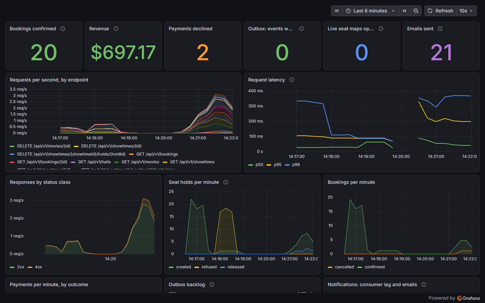

A paid booking is one trace: the request, its Redis calls, the outbox publish, the Kafka message and the notifications service that sent the email.

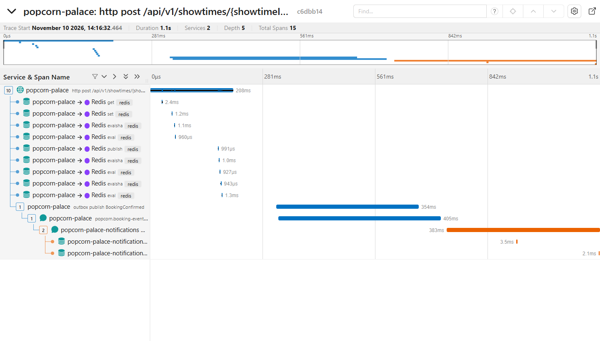

Every API response carries the trace id in its `X-Trace-Id` header, and the web client shows it as the reference of an error, so a customer's complaint leads straight to the request.

## Technology

| Layer | What |
| --- | --- |
| Web client | Next.js 16 (App Router, Server Components and Server Actions), React 19, TypeScript, Tailwind CSS 4 |
| API | Java 21, Spring Boot 4, Spring Security (JWT), Spring Data JPA, Flyway, springdoc OpenAPI |
| Data | PostgreSQL 17, Redis 8, Kafka 4 (KRaft) |
| Observability | Micrometer, OpenTelemetry, Prometheus, Grafana, Jaeger |
| Tests | JUnit, Testcontainers, Vitest, Testing Library, Playwright |
| Delivery | Docker, Docker Compose, GitHub Actions |

## Tests

| Suite | Count | What it runs against |
| --- | --- | --- |
| API | 263 | The application over HTTP with real PostgreSQL, Redis and Kafka (Testcontainers) |
| Notifications service | 14 | Real Kafka and Redis, an in-memory mail server |
| Web client, unit and component | 118 | The rules of the seat map, the checkout, time zones, pictures and errors, without a browser |
| End to end | 23 | A real browser against the whole stack: a booking has to arrive as an email |

All of it runs in CI on every pull request. The end-to-end job starts the stack with `docker compose`, the same way the section above does.

```sh
cd backend && ./mvnw verify          # the same in notifications/
cd frontend && npm test              # unit and component tests
cd frontend && npm run e2e           # needs the Docker stack running
```

On Windows use `.\mvnw.cmd verify`. The Java tests need Docker running.

## Run the services from your IDE instead

Requirements: Java 21, Node.js 22 and Docker.

Start only the infrastructure:

```sh
docker compose up -d db redis kafka mailpit jaeger
```

Then start the API (and, the same way from `notifications/`, the notifications service):

```sh
cd backend
./mvnw spring-boot:run
```

Set `DEMO_DATA=true` to get the demo programme here too. And the web client:

```sh
cd frontend
npm install
npm run dev
```

The API finds the database through `DB_URL`, `DB_USERNAME` and `DB_PASSWORD`, which default to the compose database; the web client finds the API through `API_URL`, which defaults to http://localhost:8080.

## What it is not

- **Payments are a sandbox.** A token stands in for a card. A real provider would replace one class; the idempotency, refund and reconciliation logic around it is real.
- **One cinema.** There is one programme and one time zone, not a chain.
- **No refresh tokens.** A session lasts as long as its access token, one hour.
- **The pictures are not its own.** Film information, posters and stills come from TMDB and are served by TMDB's picture servers; the API stores their addresses, not the files. This product uses the TMDB API but is not endorsed or certified by TMDB.
- **One small server.** The public site is the whole stack on one machine ([Running it on a server](deploy/README.md)): no backups, no second machine, no alerts. The programme is real, the cinema is not.

## Repository

```text
frontend/        the web client
backend/         the booking API
notifications/   the service that emails tickets
observability/   Prometheus configuration and the Grafana dashboard
compose.yml      the whole stack
compose.prod.yml what changes when the stack runs on a server
deploy/          the web server in front of it, and the scripts that release it
docs/            the pictures on this page
```

- [Web client](frontend/README.md): how the browser, the client and the API fit together, the seat map, time, rendering, tests
- [Booking API](backend/README.md): the API, errors, business rules and where they are enforced, events, observability
- [Notifications service](notifications/README.md)
- [Running it on a server](deploy/README.md): what production changes, how a release happens, setting a server up

This repository combines `antoniosifov/popcorn-palace` and `antoniosifov/popcorn-palace-frontend`; both histories are preserved through the import merge. The static pages that `frontend/` held before the Next.js client are in that history as well.

Built by Anton Iosifov: [portfolio](https://antoniosifov.com) · [LinkedIn](https://www.linkedin.com/in/anton-iosifov/)

The code is under the [MIT licence](LICENSE). Film information and artwork belong to their owners and come from TMDB; they are not part of this repository.
