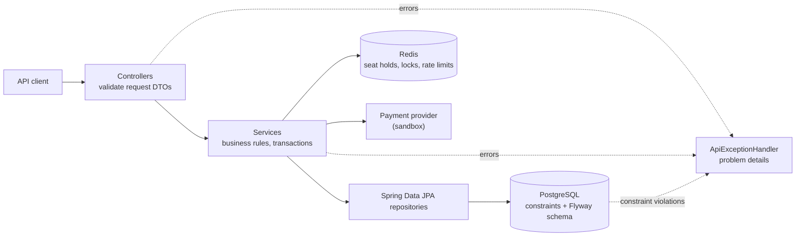

# Popcorn Palace API

A movie ticket booking backend built with Java 21 and Spring Boot 4. It manages a movie catalog, halls with real seat layouts and showtimes with per-category prices, and lets registered users hold seats while they check out, pay for them and cancel later. Its rules stay intact when requests race each other.

[Frontend](../frontend/README.md) · [Portfolio](https://antoniosifov.com) · [LinkedIn](https://www.linkedin.com/in/anton-iosifov/)

## Highlights

- Versioned REST API (`/api/v1`) with request/response DTOs, pagination and an allow-list for sorting
- Halls with row-by-row seat layouts, and a seat map per showtime with prices and availability
- Accounts with stateless JWT authentication and two roles: customers book, administrators manage the catalog
- Checkout with temporary seat holds in Redis (atomic Lua scripts, automatic expiry) confirmed into bookings in PostgreSQL
- Payments that are safe to retry: idempotency keys, a refund if the booking fails after the charge, and a job that settles payments left unfinished
- Cancellation with refund; the seats go back on sale while the booking stays on record
- Login and registration throttled per client address
- Interactive API documentation generated from the code (Swagger UI, OpenAPI 3.1)
- Database schema owned by Flyway migrations that carry existing data forward; Hibernate only validates it
- Business rules enforced by database constraints, so they hold under concurrency
- Uniform error responses in the RFC 9457 "problem details" format with machine-readable codes
- 181 automated tests, most of them calling the API over HTTP against a real PostgreSQL and Redis

## Architecture

The code is organized by feature. Each feature package holds its controller, service, repository, entity and DTOs; `common` holds what they share.



```text
src/main/java/com/antoniosifov/popcornpalace/
├── movie/       # catalog
├── hall/        # halls and their seats
├── showtime/    # scheduling, prices per seat category
├── hold/        # temporary seat holds in Redis
├── payment/     # payments, the provider interface and its sandbox, reconciliation
├── checkout/    # paying for a hold and turning it into a booking
├── booking/     # bookings and their cancellation
├── seatmap/     # seat map of a showtime: available, held, booked
├── user/        # accounts
├── auth/        # registration, login, token issuing
├── security/    # who may call what, token verification
└── common/      # error handling, pagination, configuration
src/main/resources/db/migration/   # Flyway SQL migrations
```

Packages depend on each other in one direction only: `checkout` → `hold` → `booking` → `payment`, and `booking` → `showtime` → `hall`, `movie`.

## Technology

| Area | Technologies |
| --- | --- |
| Runtime | Java 21, Spring Boot 4.1 |
| API | Spring Web MVC, Bean Validation, springdoc-openapi |
| Security | Spring Security (OAuth2 resource server), self-issued JWT (HS256), BCrypt |
| Persistence | Spring Data JPA, Hibernate 7, PostgreSQL 17, Flyway |
| Holds and rate limits | Redis 8, Spring Data Redis, Lua scripts |
| Testing | JUnit 5, MockMvc, Testcontainers (PostgreSQL, Redis), AssertJ |
| Tooling | Maven Wrapper, Docker, Docker Compose, GitHub Actions, Lombok |

## API

Base URL: `http://localhost:8080/api/v1`. Interactive documentation: http://localhost:8080/swagger-ui.html (OpenAPI JSON at `/v3/api-docs`).

| Method | Endpoint | Purpose | Who | Success |
| --- | --- | --- | --- | --- |
| `POST` | `/auth/register` | Create a customer account, returns a token | anyone | `201` |
| `POST` | `/auth/login` | Log in, returns a token | anyone | `200` |
| `GET` | `/users/me` | The account that owns the token | logged in | `200` |
| `GET` | `/movies` | List movies (paginated) | anyone | `200` |
| `GET` | `/movies/{id}` | Get a movie | anyone | `200` |
| `POST` | `/movies` | Add a movie | admin | `201` + `Location` |
| `PUT` | `/movies/{id}` | Replace a movie | admin | `200` |
| `DELETE` | `/movies/{id}` | Delete a movie | admin | `204` |
| `GET` | `/halls` | List halls (paginated) | anyone | `200` |
| `GET` | `/halls/{id}` | Get a hall with its row-by-row layout | anyone | `200` |
| `POST` | `/halls` | Create a hall and its seats | admin | `201` + `Location` |
| `DELETE` | `/halls/{id}` | Delete a hall and its seats | admin | `204` |
| `GET` | `/showtimes` | List showtimes (paginated, optional `movieId` filter) | anyone | `200` |
| `GET` | `/showtimes/{id}` | Get a showtime | anyone | `200` |
| `POST` | `/showtimes` | Schedule a showtime | admin | `201` + `Location` |
| `PUT` | `/showtimes/{id}` | Replace a showtime | admin | `200` |
| `DELETE` | `/showtimes/{id}` | Delete a showtime | admin | `204` |
| `GET` | `/showtimes/{id}/seats` | Seat map: every seat with price and status | anyone | `200` |
| `POST` | `/showtimes/{id}/holds` | Hold seats for a few minutes | logged in | `201` |
| `GET` | `/showtimes/{id}/holds/mine` | My current hold for this showtime | logged in | `200` |
| `DELETE` | `/showtimes/{id}/holds/{holdId}` | Release a hold | owner | `204` |
| `POST` | `/showtimes/{id}/holds/{holdId}/confirm` | Pay for a hold and turn it into a booking (needs `Idempotency-Key`) | owner | `201` + `Location` |
| `GET` | `/bookings` | List my bookings (paginated, newest first) | logged in | `200` |
| `GET` | `/bookings/{id}` | Get a booking | owner or admin | `200` |
| `POST` | `/bookings/{id}/cancel` | Cancel a booking and refund it | owner or admin | `200` |

### Authentication and roles

Browsing is public. Everything else needs an access token, sent as `Authorization: Bearer <accessToken>`.

Register (or log in with `email` and `password` at `/auth/login`):

```json
{
  "email": "anna@example.com",
  "password": "correct-horse-battery",
  "displayName": "Anna"
}
```

Both calls return a token and the account:

```json
{
  "accessToken": "eyJhbGciOiJIUzI1NiJ9...",
  "tokenType": "Bearer",
  "expiresIn": 3600,
  "user": { "id": "85df2e82-eb22-4966-8885-8234a8556154", "email": "anna@example.com", "displayName": "Anna", "role": "CUSTOMER", "createdAt": "2030-01-10T12:00:00.000Z" }
}
```

| Role | Can do |
| --- | --- |
| anonymous | Register, log in, browse movies, halls, showtimes and seat maps |
| `CUSTOMER` | The above, plus book seats and see their own bookings |
| `ADMIN` | Everything, including managing movies, halls and showtimes and opening any booking |

Design decisions:

- **Stateless tokens.** The API signs its own JWTs (HS256) and verifies signature, issuer and expiry on every request. There is no session and no token table. A token carries only the account id and role.
- **The user comes from the token, never from the request body.** A booking request has no user field, so one user cannot book as another.
- **Registration cannot grant a role.** Every registration creates a `CUSTOMER`. The first administrator is created at startup from `ADMIN_EMAIL` and `ADMIN_PASSWORD`; an existing account is never overwritten.
- **Login does not reveal which emails exist.** An unknown email and a wrong password get the same `401 INVALID_CREDENTIALS`, and the password hash comparison runs in both cases so the response time is similar.
- **Someone else's booking is a `404`, not a `403`.** A `403` would confirm that the id exists.
- **Passwords are stored only as BCrypt hashes** and are kept out of logs (`toString` of the request objects masks them).

- **Login and registration are throttled.** Ten attempts per client address per minute across both endpoints, counted in Redis so all instances share the count; after that the API answers `429 TOO_MANY_REQUESTS` with a `Retry-After` header. If Redis is down the limiter lets requests through rather than locking everyone out.

Not implemented yet: refresh tokens.

### Request bodies

Movie:

```json
{
  "title": "Interstellar",
  "genre": "Science Fiction",
  "durationMinutes": 169,
  "rating": 8.7,
  "releaseYear": 2014
}
```

Hall. The layout is given as blocks of identical rows, from the screen to the back; rows are numbered across blocks. This example creates rows 1–8 with 12 standard seats and rows 9–10 with 10 VIP seats. A layout cannot be changed after creation, because bookings point at individual seats.

```json
{
  "name": "Hall 1",
  "sections": [
    { "rows": 8, "seatsPerRow": 12, "category": "STANDARD" },
    { "rows": 2, "seatsPerRow": 10, "category": "VIP" }
  ]
}
```

Showtime. Times are ISO-8601 instants; any UTC offset is accepted and responses are in UTC. Every seat category used in the hall needs a price.

```json
{
  "movieId": 1,
  "hallId": 1,
  "startTime": "2030-01-15T18:00:00Z",
  "endTime": "2030-01-15T20:49:00Z",
  "prices": { "STANDARD": 14.50, "VIP": 22.00 }
}
```

Hold. The seat ids come from the showtime's seat map; the user comes from the access token.

```json
{
  "seatIds": [100, 101]
}
```

```json
{
  "id": "711c015e-6ea7-4222-bb31-87e2188ca53e",
  "showtimeId": 1,
  "seats": [
    { "seatId": 100, "row": 9, "seatNumber": 4, "category": "VIP", "price": 22.00 },
    { "seatId": 101, "row": 9, "seatNumber": 5, "category": "VIP", "price": 22.00 }
  ],
  "totalPrice": 44.00,
  "expiresAt": "2030-01-10T12:10:00.000Z"
}
```

Paying for the hold. The request needs an `Idempotency-Key` header and a payment token:

```text
POST /api/v1/showtimes/1/holds/711c015e-6ea7-4222-bb31-87e2188ca53e/confirm
Idempotency-Key: 3f1c2b9e-7d4a-4c1e-9b0a-2f6d8e5c1a77
```

```json
{
  "paymentToken": "tok_visa"
}
```

The token stands in for a card; card numbers are never sent to this API. The payment provider is a sandbox, and the token decides the outcome:

| Token | Outcome |
| --- | --- |
| `tok_visa` | charged |
| `tok_slow` | charged after a delay |
| `tok_declined` | declined: insufficient funds |
| `tok_expired` | declined: expired card |
| `tok_error` | the provider fails |

The response is the booking: the movie, hall and start time, one ticket per seat, the total and the payment. Prices are copies of what the customer was shown when the seats were held, so later price changes do not rewrite them:

```json
{
  "id": "860324e2-4308-4888-9252-9c1b1805972a",
  "status": "CONFIRMED",
  "showtimeId": 1,
  "movieTitle": "Interstellar",
  "hallName": "Hall 1",
  "startTime": "2030-01-15T18:00:00Z",
  "seats": [
    { "seatId": 100, "row": 9, "seatNumber": 4, "category": "VIP", "price": 22.00 },
    { "seatId": 101, "row": 9, "seatNumber": 5, "category": "VIP", "price": 22.00 }
  ],
  "totalPrice": 44.00,
  "payment": { "id": "5b0f6f0e-3d1c-4b53-9a57-0d1b5a1c2e90", "status": "SUCCEEDED", "amount": 44.00, "currency": "USD" },
  "userId": "85df2e82-eb22-4966-8885-8234a8556154",
  "createdAt": "2030-01-10T12:03:00.000Z",
  "cancelledAt": null
}
```

### Seat map

`GET /showtimes/{id}/seats` returns everything a client needs to draw the hall and let a customer pick seats (shortened). A seat is `AVAILABLE`, `HELD` (someone is checking out; it becomes available again if they do not finish) or `BOOKED`. The endpoint is public; when it is called with an access token, the caller's own held seats have `heldByMe: true`.

```json
{
  "showtimeId": 1,
  "hallId": 1,
  "hallName": "Hall 1",
  "totalSeats": 116,
  "availableSeats": 113,
  "rows": [
    {
      "row": 9,
      "seats": [
        { "seatId": 99, "number": 3, "category": "VIP", "price": 22.00, "status": "AVAILABLE", "heldByMe": false },
        { "seatId": 100, "number": 4, "category": "VIP", "price": 22.00, "status": "HELD", "heldByMe": true },
        { "seatId": 102, "number": 6, "category": "VIP", "price": 22.00, "status": "BOOKED", "heldByMe": false }
      ]
    }
  ]
}
```

### Pagination and sorting

List endpoints take `page` (zero-based), `size` (default 20, capped at 100) and `sort` (`field,asc|desc`).

```text
GET /api/v1/movies?page=0&size=20&sort=releaseYear,desc
```

```json
{
  "content": [{ "id": 1, "title": "Interstellar", "genre": "Science Fiction", "durationMinutes": 169, "rating": 8.7, "releaseYear": 2014 }],
  "page": 0,
  "size": 20,
  "totalElements": 1,
  "totalPages": 1
}
```

Sorting is limited to an allow-list per resource (movies: `id`, `title`, `genre`, `durationMinutes`, `rating`, `releaseYear`; halls: `id`, `name`, `rowCount`, `seatCount`; showtimes: `id`, `startTime`, `endTime`; bookings: `createdAt`, `totalPrice`). Any other field returns `400 INVALID_SORT`.

## Errors

Every error is an `application/problem+json` response ([RFC 9457](https://www.rfc-editor.org/rfc/rfc9457)) with a stable `code` that clients can branch on:

```json
{
  "title": "Conflict",
  "status": 409,
  "detail": "Some of the seats are being booked by another customer",
  "instance": "/api/v1/showtimes/1/holds",
  "code": "SEAT_ALREADY_HELD",
  "seatIds": [101]
}
```

Seat conflicts carry `seatIds`, so a client can mark exactly the seats that were lost.

Validation failures list every rejected field:

```json
{
  "title": "Bad Request",
  "status": 400,
  "detail": "Request validation failed",
  "instance": "/api/v1/movies",
  "code": "VALIDATION_FAILED",
  "errors": [
    { "field": "durationMinutes", "message": "must be greater than 0" },
    { "field": "title", "message": "must not be blank" }
  ]
}
```

| Status | Code | When |
| --- | --- | --- |
| `400` | `VALIDATION_FAILED` | A request field is missing or invalid |
| `400` | `MALFORMED_REQUEST` | The body is missing or is not valid JSON |
| `400` | `INVALID_SORT` | Sorting by a field outside the allow-list |
| `400` | `IDEMPOTENCY_KEY_REQUIRED` | Paying without a valid `Idempotency-Key` header |
| `400` | `HALL_TOO_LARGE` | A hall layout over 60 rows or 1000 seats |
| `400` | `SHOWTIME_PRICE_MISSING` | No price for a seat category the hall uses |
| `400` | `SEAT_NOT_IN_HALL` | Holding a seat that is not in the showtime's hall |
| `400` | `TOO_MANY_SEATS` | Holding more than eight seats at once |
| `401` | `UNAUTHENTICATED` | No access token, or one that is invalid or expired (with a `WWW-Authenticate: Bearer` header) |
| `401` | `INVALID_CREDENTIALS` | Login with an unknown email or a wrong password |
| `402` | `PAYMENT_DECLINED` | The card was declined (reason in `declineCode`); the seats stay held |
| `403` | `FORBIDDEN` | The account's role does not allow the action |
| `404` | `MOVIE_NOT_FOUND`, `HALL_NOT_FOUND`, `SHOWTIME_NOT_FOUND`, `SEAT_NOT_FOUND`, `BOOKING_NOT_FOUND` | The resource does not exist |
| `404` | `HOLD_NOT_FOUND` | The hold does not exist, has expired, or belongs to someone else |
| `409` | `EMAIL_TAKEN`, `MOVIE_TITLE_TAKEN`, `HALL_NAME_TAKEN` | The email or name is already in use |
| `409` | `MOVIE_HAS_SHOWTIMES`, `HALL_HAS_SHOWTIMES` | Deleting a movie or hall that still has showtimes |
| `409` | `SHOWTIME_OVERLAP` | The showtime overlaps another one in the same hall |
| `409` | `SHOWTIME_HAS_BOOKINGS` | Deleting a showtime with bookings, or moving it to another hall |
| `409` | `SHOWTIME_ALREADY_STARTED` | Holding or booking seats of a showtime that has already started |
| `409` | `SEAT_ALREADY_HELD` | A requested seat is held by another customer |
| `409` | `SEAT_ALREADY_BOOKED` | A requested seat is already booked for this showtime |
| `409` | `HOLD_ALREADY_EXISTS` | The user already has a hold for this showtime (its id is in `holdId`) |
| `409` | `PAYMENT_IN_PROGRESS` | Another request is paying for the same hold, or the same key is still being processed |
| `409` | `PAYMENT_REFUNDED` | Repeating a request whose charge was refunded because the booking could not be saved |
| `409` | `CONCURRENT_UPDATE` | Two requests changed the same booking at once; retry |
| `422` | `IDEMPOTENCY_KEY_REUSED` | The key was already used for a different purchase |
| `429` | `TOO_MANY_REQUESTS` | Too many login or registration attempts; see the `Retry-After` header |
| `502` | `PAYMENT_PROVIDER_UNAVAILABLE` | The payment provider failed; nobody was charged |
| `503` | `SERVICE_UNAVAILABLE` | PostgreSQL or Redis cannot be reached |

Errors raised by the framework (unknown path, unsupported method or media type) use the same format, with the HTTP status name as the code, for example `NOT_FOUND`. Authentication and authorization failures are raised inside Spring Security's filter chain and are routed to the same handler, so they have the same shape too.

## Business rules and where they are enforced

Request validation gives early, precise errors. The database constraint is what guarantees the rule, including when two requests arrive at the same moment.

| Rule | Request / service | Database |
| --- | --- | --- |
| Emails unique, ignoring letter case | `RegisterRequest` lowercases, service check | `uq_users_email`, `CHECK (email = lower(email))` |
| A booking belongs to an existing account | user id taken from the token | `fk_bookings_user` |
| Movie fields valid; titles unique | `MovieRequest`, service check | `CHECK` constraints, `uq_movies_title` |
| Hall names unique; layout within size limits | `HallRequest`, service check | `uq_halls_name` |
| A seat position exists once per hall | — | `uq_seats_position` |
| Showtime ends after it starts; prices not negative | `ShowtimeRequest` | `CHECK` constraints |
| Every seat category of the hall has a price | service check | — |
| Showtimes in one hall do not overlap (back-to-back is allowed) | service query | exclusion constraint `ex_showtimes_hall_time` |
| A seat is held by at most one customer at a time | atomic Lua script in Redis | — |
| A seat has at most one active sale per showtime | seat hold | partial unique index `uq_booking_seats_showtime_seat` |
| A purchase attempt is charged at most once | checkout lock in Redis | `uq_payments_user_idempotency_key` |
| A payment pays for at most one booking | — | partial unique index `uq_bookings_payment` |
| A booked seat belongs to the showtime's hall, and to its booking's showtime | service check | composite foreign keys on `booking_seats` |
| Movies and halls with showtimes, and showtimes with bookings, cannot be deleted | — | foreign keys |

Constraint violations are translated to API errors by constraint name in one place (`ConstraintErrors`).

### Checkout: holding seats, then booking them

A customer who has picked seats needs a few minutes to pay. During that time nobody else should be able to take those seats, and if the customer walks away the seats must come back on their own.

```mermaid
sequenceDiagram
    participant C as Customer
    participant A as API
    participant R as Redis
    participant P as PostgreSQL
    participant Pay as Payment provider
    C->>A: POST /showtimes/1/holds {seatIds}
    A->>R: Lua: all seats free? then take them (TTL 10 min)
    A->>P: any of them already sold?
    A-->>C: 201 hold, expiresAt
    C->>A: POST /holds/{id}/confirm (Idempotency-Key, paymentToken)
    A->>P: seen this key before? then replay the answer
    A->>R: lock the hold; Lua: hold intact? keep it alive
    A->>P: INSERT payment PENDING, commit
    A->>Pay: charge (reference = payment id)
    A->>P: INSERT booking + seats, payment SUCCEEDED (one transaction)
    A->>R: Lua: release the hold; unlock
    A-->>C: 201 booking
```

**Holds live in Redis, sold seats live in PostgreSQL.** A hold is a set of keys with a time to live, so an abandoned checkout frees its seats without any cleanup job:

```text
hold:{42}:seat:17         -> hold id    one key per held seat
hold:{42}:rec:<hold id>   -> JSON       the hold: owner, seats, prices
hold:{42}:user:<user id>  -> hold id    one hold per user per showtime
```

- **All or nothing.** Taking several seats is a Lua script, which Redis runs as one uninterruptible step: either every requested seat is free and all are taken, or nothing changes and the response lists the seats that were not free. No customer ends up with half a selection, and there is no lock ordering to get wrong.
- **Release only what is yours.** The release script deletes a seat key only if it still holds this hold's id, so releasing an expired hold cannot free a seat that someone else has since taken.
- **Confirm in a safe order.** The hold is first checked and kept alive, then the customer is charged and the booking is committed in PostgreSQL, and only then are the keys released. Releasing first would let another customer take a seat before the sale is committed.
- **Prices are fixed at hold time.** The hold stores the prices the customer was shown; confirming charges those even if an administrator changes the showtime's prices in between.
- **`{42}` is a hash tag.** It puts every key of a showtime in the same slot, which Redis Cluster requires of keys used in one script.

**Redis is not what prevents a double sale.** It keeps customers out of each other's way; the guarantee is the unique constraint `uq_booking_seats_showtime_seat`. That is why the failure modes are harmless:

| If | Then |
| --- | --- |
| Redis loses all its keys | Customers in checkout get `404 HOLD_NOT_FOUND` and pick seats again; nothing is sold twice |
| The application dies after committing a booking but before releasing the hold | The leftover keys expire; the seat map reads sold seats from PostgreSQL, so the seat shows as `BOOKED` |
| Redis is unreachable | Holding seats answers `503`; browsing and the seat map keep working (without holds) |
| The same hold is paid for twice at once | One request pays and books; the others get `409 PAYMENT_IN_PROGRESS` before any money moves |

`HoldConcurrencyTest` has 50 customers request the same two seats in the same instant and asserts that exactly one gets both and the other 49 are left with nothing. With the "is the seat free?" check removed from the script, all 50 "won". A second test uses overlapping pairs of seats and asserts that nobody ever holds half a pair; a third pays for one hold ten times at once and asserts one charge and one booking.

### Paying: charging exactly once

A payment involves three systems (Redis, the payment provider, PostgreSQL) and no transaction spans them. A request can also simply be sent twice: the customer double-clicks, or the response is lost and the client retries. The design goal is that none of this charges a customer twice or takes money without giving a booking.

- **Idempotency keys.** The client generates a unique `Idempotency-Key` per purchase attempt. The payment row is the record of that key: `uq_payments_user_idempotency_key` makes a second payment with the same key impossible to store. A repeated request is answered from the recorded payment, with `Idempotent-Replayed: true`, without touching the provider. A decline is replayed as the same decline. Using the key for a different hold is `422`.
- **Recorded before charged.** The payment is saved as `PENDING` and committed before the provider is called, so there is always a trace of an attempt.
- **No database transaction around the provider call.** A slow provider would otherwise hold database connections, and a rollback could erase the record of a charge that did happen.
- **Booking and payment succeed together.** Saving the booking and marking the payment `SUCCEEDED` is one transaction.
- **A lock before the charge.** Only one request at a time may pay for a given hold (a Redis key set with `NX` and a time to live, released only by its owner). A second request is refused before any money moves.
- **A refund if the booking fails.** If the customer was charged and the booking then cannot be saved, the charge is refunded immediately and the payment becomes `REFUNDED`.
- **A job for whatever is left.** If the application dies between the charge and the booking, the payment stays `PENDING`. `PaymentReconciler` runs every minute, asks the provider what happened to payments untouched for five minutes, and refunds the ones that were charged. It also retries refunds that could not be sent. Every step is safe to repeat, so several instances may run it.

| If | Then |
| --- | --- |
| The response is lost and the client retries with the same key | The recorded booking is returned; no second charge |
| The card is declined | `402`; the seats stay held; a new attempt with a new key can succeed |
| The provider fails | `502`; nobody is charged; the payment is recorded as `FAILED` |
| The charge succeeds but the booking cannot be saved | The charge is refunded at once; `409` |
| The application dies after the charge | The reconciliation job refunds it |
| The lock in Redis is lost and several requests charge | The unique index lets one booking through; every other charge is refunded |

`CheckoutConcurrencyTest` sends the same request ten times at once and asserts one charge. `CheckoutWithoutLockTest` removes the lock on purpose: several requests do charge the customer, exactly one booking is created, and every other charge is refunded, leaving one net charge and no unfinished payment.

### Cancelling a booking

`POST /bookings/{id}/cancel` is allowed for the owner and administrators until the showtime starts.

- **The seats go back on sale, the booking stays on record.** The seat rows are marked inactive instead of being deleted, and the "one sale per seat" rule is a partial unique index over active rows only: `CREATE UNIQUE INDEX ... ON booking_seats (showtime_id, seat_id) WHERE active`. The seat can be sold again while the cancelled booking keeps its tickets as history.
- **Cancel first, refund second.** The cancellation is committed together with the fact that a refund is owed (`REFUND_PENDING`); only then is the provider called. If the provider is down, the customer still gets a cancelled booking, the seat is still freed, and the reconciliation job completes the refund later.
- **Repeating is harmless.** Cancelling a cancelled booking returns it unchanged. Two simultaneous cancellations are separated by optimistic locking (a `version` column): one proceeds, the other is told to retry, and the booking is refunded once.

### Overlapping showtimes

The same problem exists for scheduling: two managers can pass the overlap check at the same moment. The rule therefore lives in PostgreSQL as an exclusion constraint over the hall and the half-open time range:

```sql
EXCLUDE USING gist (hall_id WITH =, tstzrange(start_time, end_time, '[)') WITH &&)
```

`ShowtimeConcurrencyTest` fires 20 simultaneous requests for the same hall and time and asserts that exactly one showtime is created. With the constraint removed, the same test created 10 overlapping showtimes.

### A seat that is not in the hall

`booking_seats` repeats the showtime and hall ids and has three composite foreign keys: to its booking `(booking_id, showtime_id)`, to the showtime `(showtime_id, hall_id)` and to the seat `(seat_id, hall_id)`. Together they make it impossible to store a seat from another hall or a seat row that disagrees with its booking, and they stop a showtime that already has bookings from being moved to another hall.

## Migrations

| Version | What it does |
| --- | --- |
| `V1` | Movies, showtimes, bookings |
| `V2` | Halls, seats, prices per seat category, exclusion constraint for overlaps; bookings point at seats |
| `V3` | Users; bookings reference the account that made them |
| `V4` | A booking can contain several seats (`booking_seats`) |
| `V5` | Payments; bookings get a status and a payment; cancelled seats stop blocking new sales |

`V2` migrates existing data instead of dropping it: each distinct theater name becomes a hall with 15 × 20 seats (the first API accepted seat numbers 1–300), the old showtime price becomes its standard price, and each booking is pointed at its seat and keeps the price it was sold for. `V3` gives the user ids carried by older bookings placeholder accounts that cannot be logged into, so the new foreign key holds. `V4` turns each existing single-seat booking into an order with one seat row. `SchemaMigrationTest` builds a database at `V1`, fills it, migrates to the latest version and checks the result.

## Run locally

### Requirements

- Docker (Docker Desktop on Windows/macOS)
- Java 21, only when running the API outside Docker

### Everything in Docker

From the repository root:

```bash
docker compose up --build
```

The API listens on http://localhost:8080 and Flyway creates the schema on first start. Compose also creates a development administrator, `admin@popcorn.local` with the password `admin-dev-password`; change both in `.env` (see `.env.example`) for anything that is not your own machine.

### API from your IDE

Start only the database and Redis, from the repository root:

```bash
docker compose up -d db redis
```

Then, from `backend/`:

macOS/Linux:

```bash
./mvnw spring-boot:run
```

Windows:

```powershell
.\mvnw.cmd spring-boot:run
```

### Configuration

| Variable | Purpose | Default |
| --- | --- | --- |
| `DB_URL`, `DB_USERNAME`, `DB_PASSWORD` | Database connection | the compose database |
| `REDIS_HOST`, `REDIS_PORT` | Redis connection | `localhost:6379` |
| `HOLD_TTL` | How long held seats stay reserved (ISO-8601 duration) | `PT10M` |
| `PAYMENT_CURRENCY` | ISO 4217 code of the currency all prices are in | `USD` |
| `AUTH_RATE_LIMIT` | Login and registration attempts per client address per minute | `10` |
| `JWT_SECRET` | Key that signs access tokens, at least 32 characters | empty: a random key per start, so tokens stop working after a restart |
| `JWT_TTL` | Lifetime of an access token (ISO-8601 duration) | `PT1H` |
| `ADMIN_EMAIL`, `ADMIN_PASSWORD` | Administrator created at startup if missing | none outside compose |
| `CORS_ALLOWED_ORIGIN_PATTERNS` | Browser origins allowed to call the API | any `localhost` port |

## Tests

macOS/Linux:

```bash
./mvnw verify
```

Windows:

```powershell
.\mvnw.cmd verify
```

Docker must be running: the API tests start disposable PostgreSQL and Redis containers through Testcontainers and call the application over HTTP, so they exercise JSON mapping, validation, security, transactions, migrations, constraints and the Redis scripts together. Rules that need no database (text normalization, request validation, sort allow-list) have plain unit tests.

Current suite: **181 tests passing**.
