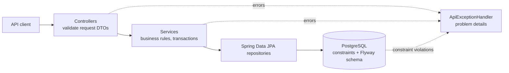

# Popcorn Palace API

A movie ticket booking backend built with Java 21 and Spring Boot 4. It manages a movie catalog, schedules showtimes and books seats, and keeps its rules intact when requests race each other.

[Frontend](../frontend/README.md) · [Portfolio](https://antoniosifov.com) · [LinkedIn](https://www.linkedin.com/in/anton-iosifov/)

## Highlights

- Versioned REST API (`/api/v1`) with request/response DTOs, pagination and an allow-list for sorting
- Interactive API documentation generated from the code (Swagger UI, OpenAPI 3.1)
- Database schema owned by Flyway migrations; Hibernate only validates it
- Business rules enforced by database constraints, so they hold under concurrency
- Uniform error responses in the RFC 9457 "problem details" format with machine-readable codes
- 65 automated tests, most of them calling the API over HTTP against a real PostgreSQL

## Architecture

The code is organized by feature. Each feature package holds its controller, service, repository, entity and DTOs; `common` holds what they share.



```text
src/main/java/com/antoniosifov/popcornpalace/
├── movie/       # catalog
├── showtime/    # scheduling, overlap rule
├── booking/     # seat booking
└── common/      # error handling, pagination, configuration
src/main/resources/db/migration/   # Flyway SQL migrations
```

## Technology

| Area | Technologies |
| --- | --- |
| Runtime | Java 21, Spring Boot 4.1 |
| API | Spring Web MVC, Bean Validation, springdoc-openapi |
| Persistence | Spring Data JPA, Hibernate 7, PostgreSQL 17, Flyway |
| Testing | JUnit 5, MockMvc, Testcontainers (PostgreSQL), AssertJ |
| Tooling | Maven Wrapper, Docker, Docker Compose, GitHub Actions, Lombok |

## API

Base URL: `http://localhost:8080/api/v1`. Interactive documentation: http://localhost:8080/swagger-ui.html (OpenAPI JSON at `/v3/api-docs`).

| Method | Endpoint | Purpose | Success |
| --- | --- | --- | --- |
| `GET` | `/movies` | List movies (paginated) | `200` |
| `GET` | `/movies/{id}` | Get a movie | `200` |
| `POST` | `/movies` | Add a movie | `201` + `Location` |
| `PUT` | `/movies/{id}` | Replace a movie | `200` |
| `DELETE` | `/movies/{id}` | Delete a movie | `204` |
| `GET` | `/showtimes` | List showtimes (paginated, optional `movieId` filter) | `200` |
| `GET` | `/showtimes/{id}` | Get a showtime | `200` |
| `POST` | `/showtimes` | Schedule a showtime | `201` + `Location` |
| `PUT` | `/showtimes/{id}` | Replace a showtime | `200` |
| `DELETE` | `/showtimes/{id}` | Delete a showtime | `204` |
| `POST` | `/bookings` | Book a seat | `201` + `Location` |
| `GET` | `/bookings/{id}` | Get a booking | `200` |

### Request bodies

Movie:

```json
{
  "title": "Interstellar",
  "genre": "Science Fiction",
  "durationMinutes": 169,
  "rating": 8.7,
  "releaseYear": 2014
}
```

Showtime (times are ISO-8601 instants; any UTC offset is accepted, responses are in UTC):

```json
{
  "movieId": 1,
  "theater": "Hall 1",
  "startTime": "2030-01-15T18:00:00Z",
  "endTime": "2030-01-15T20:49:00Z",
  "price": 14.50
}
```

Booking:

```json
{
  "showtimeId": 1,
  "seatNumber": 15,
  "userId": "84438967-f68f-4fa0-b620-0f08217e76af"
}
```

### Pagination and sorting

List endpoints take `page` (zero-based), `size` (default 20, capped at 100) and `sort` (`field,asc|desc`).

```text
GET /api/v1/movies?page=0&size=20&sort=releaseYear,desc
```

```json
{
  "content": [{ "id": 1, "title": "Interstellar", "genre": "Science Fiction", "durationMinutes": 169, "rating": 8.7, "releaseYear": 2014 }],
  "page": 0,
  "size": 20,
  "totalElements": 1,
  "totalPages": 1
}
```

Sorting is limited to an allow-list per resource (movies: `id`, `title`, `genre`, `durationMinutes`, `rating`, `releaseYear`; showtimes: `id`, `theater`, `startTime`, `endTime`, `price`). Any other field returns `400 INVALID_SORT`.

## Errors

Every error is an `application/problem+json` response ([RFC 9457](https://www.rfc-editor.org/rfc/rfc9457)) with a stable `code` that clients can branch on:

```json
{
  "title": "Conflict",
  "status": 409,
  "detail": "Seat 15 is already booked for this showtime",
  "instance": "/api/v1/bookings",
  "code": "SEAT_ALREADY_BOOKED"
}
```

Validation failures list every rejected field:

```json
{
  "title": "Bad Request",
  "status": 400,
  "detail": "Request validation failed",
  "instance": "/api/v1/movies",
  "code": "VALIDATION_FAILED",
  "errors": [
    { "field": "durationMinutes", "message": "must be greater than 0" },
    { "field": "title", "message": "must not be blank" }
  ]
}
```

| Status | Code | When |
| --- | --- | --- |
| `400` | `VALIDATION_FAILED` | A request field is missing or invalid |
| `400` | `MALFORMED_REQUEST` | The body is missing or is not valid JSON |
| `400` | `INVALID_SORT` | Sorting by a field outside the allow-list |
| `404` | `MOVIE_NOT_FOUND`, `SHOWTIME_NOT_FOUND`, `BOOKING_NOT_FOUND` | The resource does not exist |
| `409` | `MOVIE_TITLE_TAKEN` | Another movie already has this title |
| `409` | `MOVIE_HAS_SHOWTIMES` | Deleting a movie that still has showtimes |
| `409` | `SHOWTIME_OVERLAP` | The showtime overlaps another one in the same theater |
| `409` | `SHOWTIME_HAS_BOOKINGS` | Deleting a showtime that has bookings |
| `409` | `SHOWTIME_ALREADY_STARTED` | Booking a showtime that has already started |
| `409` | `SEAT_ALREADY_BOOKED` | The seat is already booked for this showtime |

Errors raised by the framework (unknown path, unsupported method or media type) use the same format, with the HTTP status name as the code, for example `NOT_FOUND`.

## Business rules and where they are enforced

| Rule | Request validation | Database |
| --- | --- | --- |
| Title and genre required; text is trimmed and inner whitespace collapsed | `MovieRequest` | `NOT NULL` |
| Duration positive, rating 0.0–10.0 with one decimal, release year 1888–2100 | `MovieRequest` | `CHECK` constraints |
| Movie titles are unique | service check | `uq_movies_title` |
| Showtime ends after it starts; price is not negative | `ShowtimeRequest` | `CHECK` constraints |
| Showtimes in one theater do not overlap (back-to-back is allowed), on create and update | service query | — |
| Seat number 1–300 | `BookingRequest` | `CHECK` constraint |
| A seat is booked at most once per showtime | service check | `uq_bookings_showtime_seat` |
| A movie with showtimes and a showtime with bookings cannot be deleted | — | foreign keys |

### Double booking

Checking "is the seat free?" and then inserting is not enough: two simultaneous requests can both see the seat as free. The unique constraint `uq_bookings_showtime_seat` is the real guard. The losing insert fails in the database and the API reports it as `409 SEAT_ALREADY_BOOKED`.

`BookingConcurrencyTest` fires 30 simultaneous requests at one seat and asserts that exactly one gets `201` and one row exists. With the constraint removed, the same test produced 10 bookings for the seat.

Known limitation: the showtime overlap rule is still a check followed by an insert, so two simultaneous requests could schedule overlapping showtimes. It will move into the database (an exclusion constraint) together with the hall model.

## Run locally

### Requirements

- Docker (Docker Desktop on Windows/macOS)
- Java 21, only when running the API outside Docker

### Everything in Docker

From the repository root:

```bash
docker compose up --build
```

The API listens on http://localhost:8080 and Flyway creates the schema on first start.

### API from your IDE

Start only the database, from the repository root:

```bash
docker compose up -d db
```

Then, from `backend/`:

macOS/Linux:

```bash
./mvnw spring-boot:run
```

Windows:

```powershell
.\mvnw.cmd spring-boot:run
```

Connection settings come from `DB_URL`, `DB_USERNAME` and `DB_PASSWORD` and default to the compose database. Browser origins allowed by CORS are set with `CORS_ALLOWED_ORIGIN_PATTERNS` (default: any `localhost` port).

## Tests

macOS/Linux:

```bash
./mvnw verify
```

Windows:

```powershell
.\mvnw.cmd verify
```

Docker must be running: the API tests start a disposable PostgreSQL container through Testcontainers and call the application over HTTP, so they exercise JSON mapping, validation, transactions, migrations and constraints together. Rules that need no database (text normalization, request validation, sort allow-list) have plain unit tests.

Current suite: **65 tests passing**.
