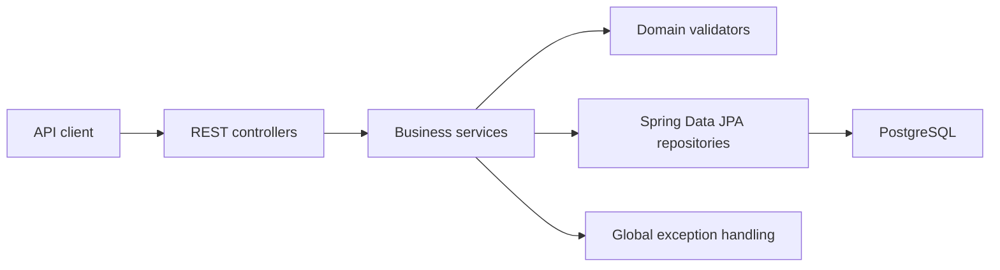

# Popcorn Palace API

A movie ticket booking backend built with Java and Spring Boot. The API manages movies, schedules theater showtimes, and creates seat bookings while enforcing validation, schedule-conflict, and duplicate-seat rules.

[Frontend](../frontend/README.md) · [Portfolio](https://antoniosifov.com) · [LinkedIn](https://www.linkedin.com/in/anton-iosifov/)

## Highlights

- Movie catalog creation, update, deletion, and retrieval
- Theater showtime management with overlap detection
- Seat booking with duplicate-seat prevention per showtime
- Layered controller, service, repository, and persistence design
- Dedicated validators and centralized JSON error responses
- PostgreSQL everywhere: local development, tests (Testcontainers) and Docker
- 28 automated tests: service unit tests plus HTTP contract tests against a real PostgreSQL

## Architecture



The REST controllers translate HTTP requests into service operations. Services own the business rules, validators reject invalid domain input, and Spring Data JPA repositories persist movies, showtimes, and bookings. `@RestControllerAdvice` maps validation and not-found failures to structured `400` and `404` responses.

## Technology

| Area | Technologies |
| --- | --- |
| Runtime | Java 21, Spring Boot 4.1 |
| API | Spring Web, REST |
| Persistence | Spring Data JPA, Hibernate, PostgreSQL |
| Testing | JUnit 5, Mockito, Testcontainers (PostgreSQL) |
| Tooling | Maven Wrapper, Docker, Docker Compose, GitHub Actions, Lombok |

## API

The application runs at `http://localhost:8080` by default.

### Movies

| Method | Endpoint | Purpose |
| --- | --- | --- |
| `GET` | `/movies/all` | List all movies |
| `POST` | `/movies` | Create a movie |
| `POST` | `/movies/update/{movieTitle}` | Update a movie by title |
| `DELETE` | `/movies/{movieTitle}` | Delete a movie by title |

Example movie payload:

```json
{
  "title": "Interstellar",
  "genre": "Science Fiction",
  "duration": 169,
  "rating": 8.7,
  "releaseYear": 2014
}
```

### Showtimes

| Method | Endpoint | Purpose |
| --- | --- | --- |
| `GET` | `/showtimes/all` | List all showtimes |
| `GET` | `/showtimes/{showtimeId}` | Get a showtime |
| `POST` | `/showtimes` | Schedule a showtime |
| `POST` | `/showtimes/update/{showtimeId}` | Update a showtime |
| `DELETE` | `/showtimes/{showtimeId}` | Delete a showtime |

Example showtime payload:

```json
{
  "movie": { "id": 1 },
  "theater": "Theater 1",
  "start_time": "2026-08-15T18:00:00",
  "end_time": "2026-08-15T20:49:00",
  "price": 14.50
}
```

Creating a showtime is rejected when its time range overlaps another showtime in the same theater.

### Bookings

| Method | Endpoint | Purpose |
| --- | --- | --- |
| `POST` | `/bookings` | Reserve a seat for a showtime |

Example booking payload:

```json
{
  "showtime": { "id": 1 },
  "seatNumber": 15,
  "userId": "84438967-f68f-4fa0-b620-0f08217e76af"
}
```

Successful bookings return a generated UUID:

```json
{
  "bookingId": "d1a6423b-4469-4b00-8c5f-e3cfc42eacae"
}
```

## Validation and error handling

- Movie titles and genres are required and normalized before persistence.
- Duration must be positive, ratings must be between `0` and `10`, and release years must be within the supported range.
- Showtimes require a valid movie, theater, time range, and non-negative price.
- Seat numbers must be between `1` and `300`.
- A seat cannot be booked twice for the same showtime.
- Invalid requests return `400 Bad Request`; missing resources return `404 Not Found`.

Example error response:

```json
{
  "statusCode": "BAD_REQUEST",
  "message": "Seat 15 is already booked for this showtime"
}
```

## Run locally

### Requirements

- Java 21
- Docker and Docker Compose

### 1. Clone the repository

```bash
git clone https://github.com/antoniosifov/popcorn-palace.git
cd popcorn-palace
```

### 2. Start PostgreSQL

```bash
docker compose -f ../compose.yml up -d db
```

The compose file creates a local database named `popcorn-palace` on port `5432`. The API reads its connection settings from `DB_URL`, `DB_USERNAME` and `DB_PASSWORD` and defaults to this database. To run the database and the API together in Docker, use `docker compose up --build` from the repository root.

### 3. Start the API

macOS/Linux:

```bash
./mvnw spring-boot:run
```

Windows:

```powershell
.\mvnw.cmd spring-boot:run
```

## Tests

The context and HTTP contract tests start a disposable PostgreSQL container through Testcontainers, so Docker must be running. Service tests are plain unit tests with mocked repositories.

macOS/Linux:

```bash
./mvnw verify
```

Windows:

```powershell
.\mvnw.cmd verify
```

Current suite: **28 tests passing** across application startup, the HTTP contract, movie services, showtime services, and booking services.

## Project structure

```text
src/
├── main/java/com/antoniosifov/popcornpalace/
│   ├── controller/    # HTTP endpoints
│   ├── service/       # Business rules and transactions
│   ├── validation/    # Input and domain validation
│   ├── repository/    # Spring Data JPA access
│   ├── model/         # Persistence entities
│   ├── dto/           # API response models
│   └── errors/        # Structured error handling
└── test/java/         # Service unit tests and the Testcontainers context test
```

## Related repository

The browser client lives in [frontend/](../frontend/README.md) in this repository.
