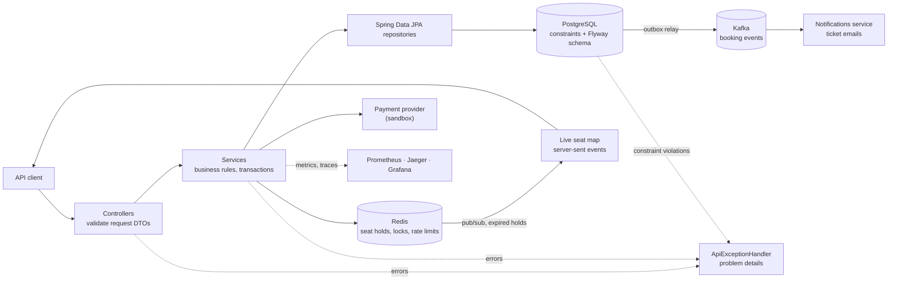
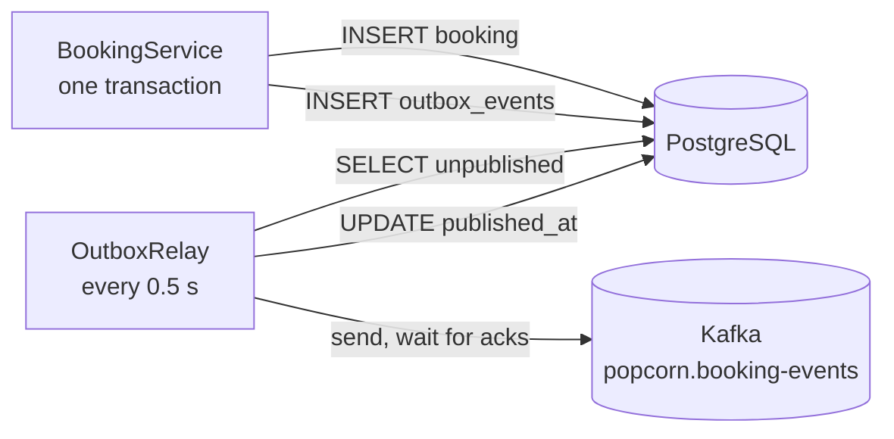
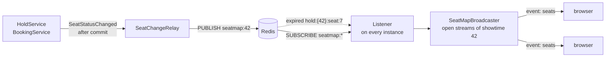
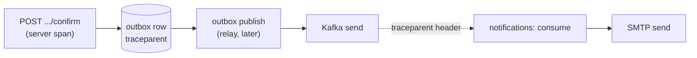

# Popcorn Palace API

A movie ticket booking backend built with Java 21 and Spring Boot 4. It manages a movie catalog, halls with real seat layouts and showtimes with per-category prices, and lets registered users hold seats while they check out, pay for them and cancel later. Its rules stay intact when requests race each other.

[Web client](../frontend/README.md) · [Notifications service](../notifications/README.md) · [Portfolio](https://antoniosifov.com) · [LinkedIn](https://www.linkedin.com/in/anton-iosifov/)

## Highlights

- Versioned REST API (`/api/v1`) with request/response DTOs, pagination and an allow-list for sorting
- Halls with row-by-row seat layouts, and a seat map per showtime with prices and availability
- Live seat map: a browser subscribes to a showtime and sees seats become held, sold and free again as it happens, whichever instance of the API made the change
- A catalogue that can keep itself current: with a TMDB key, the films in cinemas now are imported with their posters, stills, trailers and credits, and read again twice a day
- Accounts with stateless JWT authentication and two roles: customers book, administrators manage the catalog
- A forgotten password is replaced through a one-time link sent by email, and the change ends the account's earlier sessions
- Signing in with Google, with the ID token checked in full here and an account that somebody else opened first never handed over with its password
- Checkout with temporary seat holds in Redis (atomic Lua scripts, automatic expiry) confirmed into bookings in PostgreSQL
- Payments that are safe to retry: idempotency keys, a refund if the booking fails after the charge, and a job that settles payments left unfinished
- Cancellation with refund; the seats go back on sale while the booking stays on record
- Booking events published to Kafka through a transactional outbox, so an event exists if and only if the booking does; a separate service turns them into ticket emails
- Login and registration throttled per client address
- Interactive API documentation generated from the code (Swagger UI, OpenAPI 3.1)
- Database schema owned by Flyway migrations that carry existing data forward; Hibernate only validates it
- Business rules enforced by database constraints, so they hold under concurrency
- Uniform error responses in the RFC 9457 "problem details" format with machine-readable codes
- Observability built in: health probes, Prometheus metrics for the business (holds, bookings, payments, outbox backlog, open seat maps) as well as the runtime, and one OpenTelemetry trace from the booking request through the outbox and Kafka to the ticket email, with the trace id in every response
- 263 automated tests, most of them calling the API over HTTP against real PostgreSQL, Redis and Kafka

## Architecture

The code is organized by feature. Each feature package holds its controller, service, repository, entity and DTOs; `common` holds what they share.



```text
src/main/java/com/antoniosifov/popcornpalace/
├── movie/       # catalog
├── hall/        # halls and their seats
├── showtime/    # scheduling, prices per seat category
├── hold/        # temporary seat holds in Redis
├── payment/     # payments, the provider interface and its sandbox, reconciliation
├── checkout/    # paying for a hold and turning it into a booking
├── booking/     # bookings and their cancellation; booking/event: what is published about them
├── outbox/      # transactional outbox and the relay that sends it to Kafka
├── seatmap/     # seat map of a showtime (available, held, booked) and its live stream of changes
├── user/        # accounts
├── auth/        # registration, login, token issuing
├── security/    # who may call what, token verification
└── common/      # error handling, pagination, configuration, observability
src/main/resources/db/migration/   # Flyway SQL migrations
```

Packages depend on each other in one direction only: `checkout` → `hold` → `booking` → `payment`, `outbox`, and `booking` → `showtime` → `hall`, `movie`.

## Technology

| Area | Technologies |
| --- | --- |
| Runtime | Java 21, Spring Boot 4.1 |
| API | Spring Web MVC, Bean Validation, springdoc-openapi |
| Security | Spring Security (OAuth2 resource server), self-issued JWT (HS256), BCrypt |
| Persistence | Spring Data JPA, Hibernate 7, PostgreSQL 17, Flyway |
| Holds and rate limits | Redis 8, Spring Data Redis, Lua scripts |
| Events | Kafka 4.2 (KRaft), Spring Kafka, transactional outbox |
| Observability | Spring Boot Actuator, Micrometer, Prometheus, OpenTelemetry (OTLP), Jaeger, Grafana |
| Testing | JUnit 5, MockMvc, Testcontainers (PostgreSQL, Redis, Kafka), AssertJ |
| Tooling | Maven Wrapper, Docker, Docker Compose, GitHub Actions, Lombok |

## API

Base URL: `http://localhost:8080/api/v1`. Interactive documentation: http://localhost:8080/swagger-ui.html (OpenAPI JSON at `/v3/api-docs`).

| Method | Endpoint | Purpose | Who | Success |
| --- | --- | --- | --- | --- |
| `POST` | `/auth/register` | Create a customer account, returns a token | anyone | `201` |
| `POST` | `/auth/login` | Log in, returns a token | anyone | `200` |
| `POST` | `/auth/password-reset` | Ask for a link to set a new password; the answer is the same whether or not the email has an account | anyone | `202` |
| `POST` | `/auth/password-reset/confirm` | Set a new password with the token from the emailed link | anyone | `204` |
| `POST` | `/auth/google` | Sign in with a Google ID token, returns a token | anyone | `200` |
| `GET` | `/users/me` | The account that owns the token | logged in | `200` |
| `GET` | `/movies` | List movies (paginated) | anyone | `200` |
| `GET` | `/movies/{id}` | Get a movie | anyone | `200` |
| `POST` | `/movies` | Add a movie | admin | `201` + `Location` |
| `PUT` | `/movies/{id}` | Replace a movie | admin | `200` |
| `DELETE` | `/movies/{id}` | Delete a movie | admin | `204` |
| `GET` | `/halls` | List halls (paginated) | anyone | `200` |
| `GET` | `/halls/{id}` | Get a hall with its row-by-row layout | anyone | `200` |
| `POST` | `/halls` | Create a hall and its seats | admin | `201` + `Location` |
| `DELETE` | `/halls/{id}` | Delete a hall and its seats | admin | `204` |
| `GET` | `/showtimes` | List showtimes (paginated; optional `movieId`, `from` and `to` filters) | anyone | `200` |
| `GET` | `/showtimes/{id}` | Get a showtime | anyone | `200` |
| `POST` | `/showtimes` | Schedule a showtime | admin | `201` + `Location` |
| `PUT` | `/showtimes/{id}` | Replace a showtime | admin | `200` |
| `DELETE` | `/showtimes/{id}` | Delete a showtime | admin | `204` |
| `GET` | `/showtimes/{id}/seats` | Seat map: every seat with price and status | anyone | `200` |
| `GET` | `/showtimes/{id}/seats/stream` | Live changes to the seat map (server-sent events) | anyone | `200` |
| `POST` | `/showtimes/{id}/holds` | Hold seats for a few minutes | logged in | `201` |
| `GET` | `/showtimes/{id}/holds/mine` | My current hold for this showtime | logged in | `200` |
| `DELETE` | `/showtimes/{id}/holds/{holdId}` | Release a hold | owner | `204` |
| `POST` | `/showtimes/{id}/holds/{holdId}/confirm` | Pay for a hold and turn it into a booking (needs `Idempotency-Key`) | owner | `201` + `Location` |
| `GET` | `/bookings` | List my bookings (paginated, newest first) | logged in | `200` |
| `GET` | `/bookings/{id}` | Get a booking | owner or admin | `200` |
| `POST` | `/bookings/{id}/cancel` | Cancel a booking and refund it | owner or admin | `200` |

### Authentication and roles

Browsing is public. Everything else needs an access token, sent as `Authorization: Bearer <accessToken>`.

Register (or log in with `email` and `password` at `/auth/login`):

```json
{
  "email": "anna@example.com",
  "password": "correct-horse-battery",
  "displayName": "Anna"
}
```

Both calls return a token and the account:

```json
{
  "accessToken": "eyJhbGciOiJIUzI1NiJ9...",
  "tokenType": "Bearer",
  "expiresIn": 3600,
  "user": { "id": "85df2e82-eb22-4966-8885-8234a8556154", "email": "anna@example.com", "displayName": "Anna", "role": "CUSTOMER", "createdAt": "2030-01-10T12:00:00.000Z" }
}
```

| Role | Can do |
| --- | --- |
| anonymous | Register, log in, browse movies, halls, showtimes and seat maps |
| `CUSTOMER` | The above, plus book seats and see their own bookings |
| `ADMIN` | Everything, including managing movies, halls and showtimes and opening any booking |

Design decisions:

- **Stateless tokens.** The API signs its own JWTs (HS256) and verifies signature, issuer and expiry on every request. There is no session and no token table. A token carries only the account id and role.
- **The user comes from the token, never from the request body.** A booking request has no user field, so one user cannot book as another.
- **Registration cannot grant a role.** Every registration creates a `CUSTOMER`. The first administrator is created at startup from `ADMIN_EMAIL` and `ADMIN_PASSWORD`; an existing account is never overwritten.
- **Login does not reveal which emails exist.** An unknown email and a wrong password get the same `401 INVALID_CREDENTIALS`, and the password hash comparison runs in both cases so the response time is similar.
- **Someone else's booking is a `404`, not a `403`.** A `403` would confirm that the id exists.
- **Passwords are stored only as BCrypt hashes** and are kept out of logs (`toString` of the request objects masks them).

- **Login and registration are throttled.** Ten attempts per client address per minute across all four authentication endpoints (the two for a forgotten password included), counted in Redis so all instances share the count; after that the API answers `429 TOO_MANY_REQUESTS` with a `Retry-After` header. If Redis is down the limiter lets requests through rather than locking everyone out. Behind the web client or a reverse proxy every request arrives from the same address, so there the limit would count all visitors together: with `FORWARD_HEADERS_STRATEGY=native` the address is taken from the `X-Forwarded-For` header instead, trusted only when the request comes from a private network address (the proxy), and it is the address that proxy saw, not whatever the visitor put in the header.

Not implemented yet: refresh tokens.

### A forgotten password

`POST /auth/password-reset` with an email, then `POST /auth/password-reset/confirm` with the token from the emailed link and the new password.

- **The answer does not say whether the email is registered.** Always `202` with an empty body. The form would otherwise tell a stranger which addresses have accounts, which is what the login form is careful not to do.
- **The link is a secret, and only its hash is stored.** The token is 256 random bits; `password_reset_tokens` keeps its SHA-256. A fast hash is the right one here, unlike for a password: there is nothing to guess, only something that must not be readable from a backup or a mistaken query.
- **It works once, for 30 minutes, and only the newest one does.** Using a link is a `DELETE ... RETURNING`, so of several simultaneous attempts exactly one finds the row. Asking again replaces the earlier link. Unknown, expired, replaced and used tokens all get the same `400 RESET_LINK_INVALID`. A password that is rejected does not spend the link.
- **It cannot be used to fill somebody's mailbox.** On top of the limit per client address, one account is sent at most three links an hour, whoever asks and from wherever. Further requests are answered `202` like the rest and send nothing.
- **A new password ends the sessions that were open.** An access token is verified by its signature, so by itself it would outlive the change by up to an hour, which is exactly the hour a thief who knew the old password stays logged in. Each token carries the account's session version (`sv`); changing the password raises it, and `SessionVersions` refuses tokens issued for an earlier one. The new version is kept in Redis for one token lifetime, after which every older token has expired anyway. If Redis is restarted within that hour, or is down, tokens are judged by signature and expiry as before: an outage must not log everybody out.
- **The link passes through the outbox and Kafka and is kept in neither.** The email is sent the way tickets are, so it exists if and only if the request committed. But published outbox rows are normally kept for a week and Kafka keeps messages for as long: too long for a secret. The event is written as confidential (`Outbox.appendConfidential`) and deleted the moment Kafka acknowledges it, its topic keeps messages for an hour, and the notifications service neither logs the link nor parks a failed event in a dead-letter topic.

What is left: a request for a registered email does two inserts more than one for an unknown email, so the two differ by a hair in response time, though not in what they answer.

### Signing in with Google

`POST /auth/google` with the ID token Google issued and the nonce the sign-in was started with. The [web client](../frontend/README.md#signing-in-with-google) does the round trip to Google; this is where the result is judged and where accounts are opened, so nothing about the token is taken on trust.

- **The token is checked in full** (`GoogleIdTokenVerifier`): its signature against the keys Google publishes (fetched on first use and cached), the issuer, the expiry, the nonce, and the audience. The audience is the one that is easy to forget: without it, a token Google issued when the person signed in to any other site would open their account here.
- **An account is found by Google's subject, not by email.** The subject stays the same when somebody changes their address at Google; the email does not.
- **An address Google has not confirmed opens nothing** (`401 GOOGLE_EMAIL_UNVERIFIED`): it proves nothing about who is signing in.
- **An account that already uses the email is connected, and what happens to its password depends on whether its email was ever proven.** Registration with a password asks for no proof, so an account with somebody's email may have been opened by somebody else, on purpose, ahead of them. Joining it to the rightful owner's Google sign-in as it is would leave the stranger a working password to the owner's account. So `users.email_verified` records whether the email was proven (by opening a reset link, or by an earlier Google sign-in). A proven account keeps its password. An unproven one loses its password and its sessions the moment Google vouches for the owner; a password can be set again through a reset link.
- **An account opened through Google has no password**, and none matches: logging in to it with one fails like any wrong password.
- **Off unless configured.** Without `GOOGLE_CLIENT_ID` the endpoint answers `404 GOOGLE_SIGN_IN_DISABLED`, and the application never contacts Google.

`GoogleSignInApiTest` runs against a stand-in that publishes signing keys over HTTP the way Google does, so the tokens in the tests are verified by the same code path as real ones: a forged signature, another site's audience, another issuer, an expired token and a nonce from another sign-in are all refused, with one answer that does not say which check failed.

### Request bodies

Movie:

```json
{
  "title": "Interstellar",
  "genre": "Science Fiction",
  "durationMinutes": 169,
  "rating": 8.7,
  "releaseYear": 2014,
  "overview": "A team of explorers travels through a wormhole in search of a new home for humanity.",
  "posterUrl": "https://image.tmdb.org/t/p/w500/gEU2QniE6E77NI6lCU6MxlNBvIx.jpg",
  "backdropUrl": "https://image.tmdb.org/t/p/w1280/xJHokMbljvjADYdit5fK5VQsXEG.jpg",
  "trailerUrl": "https://www.youtube.com/watch?v=zSWdZVtXT7E",
  "director": "Christopher Nolan",
  "starring": ["Matthew McConaughey", "Anne Hathaway"]
}
```

The first five fields are required. The rest say how the movie is presented and are optional, as is `tagline`; the three addresses must be `https`, since they end up in pages. A response also carries `inCinemas` and `popularity`, which only the [import](#films-in-cinemas-now) sets.

Hall. The layout is given as blocks of identical rows, from the screen to the back; rows are numbered across blocks. This example creates rows 1–8 with 12 standard seats and rows 9–10 with 10 VIP seats. A layout cannot be changed after creation, because bookings point at individual seats.

```json
{
  "name": "Hall 1",
  "sections": [
    { "rows": 8, "seatsPerRow": 12, "category": "STANDARD" },
    { "rows": 2, "seatsPerRow": 10, "category": "VIP" }
  ]
}
```

Showtime. Times are ISO-8601 instants; any UTC offset is accepted and responses are in UTC. Every seat category used in the hall needs a price.

```json
{
  "movieId": 1,
  "hallId": 1,
  "startTime": "2030-01-15T18:00:00Z",
  "endTime": "2030-01-15T20:49:00Z",
  "prices": { "STANDARD": 14.50, "VIP": 22.00 }
}
```

Hold. The seat ids come from the showtime's seat map; the user comes from the access token.

```json
{
  "seatIds": [100, 101]
}
```

```json
{
  "id": "711c015e-6ea7-4222-bb31-87e2188ca53e",
  "showtimeId": 1,
  "seats": [
    { "seatId": 100, "row": 9, "seatNumber": 4, "category": "VIP", "price": 22.00 },
    { "seatId": 101, "row": 9, "seatNumber": 5, "category": "VIP", "price": 22.00 }
  ],
  "totalPrice": 44.00,
  "expiresAt": "2030-01-10T12:10:00.000Z"
}
```

Paying for the hold. The request needs an `Idempotency-Key` header and a payment token:

```text
POST /api/v1/showtimes/1/holds/711c015e-6ea7-4222-bb31-87e2188ca53e/confirm
Idempotency-Key: 3f1c2b9e-7d4a-4c1e-9b0a-2f6d8e5c1a77
```

```json
{
  "paymentToken": "tok_visa"
}
```

The token stands in for a card; card numbers are never sent to this API. The payment provider is a sandbox, and the token decides the outcome:

| Token | Outcome |
| --- | --- |
| `tok_visa` | charged |
| `tok_slow` | charged after a delay |
| `tok_declined` | declined: insufficient funds |
| `tok_expired` | declined: expired card |
| `tok_error` | the provider fails |

The response is the booking: the movie, hall and start time, one ticket per seat, the total and the payment. Prices are copies of what the customer was shown when the seats were held, so later price changes do not rewrite them:

```json
{
  "id": "860324e2-4308-4888-9252-9c1b1805972a",
  "status": "CONFIRMED",
  "showtimeId": 1,
  "movieTitle": "Interstellar",
  "hallName": "Hall 1",
  "startTime": "2030-01-15T18:00:00Z",
  "seats": [
    { "seatId": 100, "row": 9, "seatNumber": 4, "category": "VIP", "price": 22.00 },
    { "seatId": 101, "row": 9, "seatNumber": 5, "category": "VIP", "price": 22.00 }
  ],
  "totalPrice": 44.00,
  "payment": { "id": "5b0f6f0e-3d1c-4b53-9a57-0d1b5a1c2e90", "status": "SUCCEEDED", "amount": 44.00, "currency": "USD" },
  "userId": "85df2e82-eb22-4966-8885-8234a8556154",
  "createdAt": "2030-01-10T12:03:00.000Z",
  "cancelledAt": null
}
```

### Seat map

`GET /showtimes/{id}/seats` returns everything a client needs to draw the hall and let a customer pick seats (shortened). A seat is `AVAILABLE`, `HELD` (someone is checking out; it becomes available again if they do not finish) or `BOOKED`. The endpoint is public; when it is called with an access token, the caller's own held seats have `heldByMe: true`.

```json
{
  "showtimeId": 1,
  "hallId": 1,
  "hallName": "Hall 1",
  "totalSeats": 116,
  "availableSeats": 113,
  "rows": [
    {
      "row": 9,
      "seats": [
        { "seatId": 99, "number": 3, "category": "VIP", "price": 22.00, "status": "AVAILABLE", "heldByMe": false },
        { "seatId": 100, "number": 4, "category": "VIP", "price": 22.00, "status": "HELD", "heldByMe": true },
        { "seatId": 102, "number": 6, "category": "VIP", "price": 22.00, "status": "BOOKED", "heldByMe": false }
      ]
    }
  ]
}
```

### Live seat map

`GET /showtimes/{id}/seats/stream` keeps the response open and sends a `seats` event every time seats of that showtime change status (`text/event-stream`, the format browsers read with `EventSource`). The first event, `connected`, confirms the subscription; a comment line every 15 seconds keeps the connection alive. What a browser received below while another customer held two seats, released them, held one and paid for it, and a third customer's hold ran out:

```text
event:connected
data:{"showtimeId": 1}

event:seats
data:{"showtimeId":1,"seatIds":[1,2],"status":"HELD","holdId":"46e5709e-1a1b-4534-b07e-41d5ed70d62e"}

event:seats
data:{"showtimeId":1,"seatIds":[1,2],"status":"AVAILABLE","holdId":null}

event:seats
data:{"showtimeId":1,"seatIds":[3],"status":"HELD","holdId":"1e484364-0c50-4083-be08-d6fc2bb87542"}

event:seats
data:{"showtimeId":1,"seatIds":[3],"status":"BOOKED","holdId":null}

event:seats
data:{"showtimeId":1,"seatIds":[5],"status":"AVAILABLE","holdId":null}
```

A client draws the seat map from `GET /showtimes/{id}/seats`, then applies each event to it. The `holdId` lets the customer who holds the seats recognize their own hold. A stream is closed by the server after 30 minutes and whenever the instance shuts down; the browser reconnects on its own, and should reload the seat map when it does, since changes made while it was away are not replayed. How it works is described under [Live seat map](#live-seat-map-1).

### Pagination and sorting

List endpoints take `page` (zero-based), `size` (default 20, capped at 100) and `sort` (`field,asc|desc`).

```text
GET /api/v1/movies?page=0&size=20&sort=releaseYear,desc
```

Showtimes can also be asked for by when they start: `from` (included) and `to` (not included) are ISO-8601 instants, and either may be left out. This is how a client lists what is still to come, or one day of the programme:

```text
GET /api/v1/showtimes?from=2030-01-15T00:00:00Z&to=2030-01-16T00:00:00Z&sort=startTime,asc
```

```json
{
  "content": [{ "id": 1, "title": "Interstellar", "genre": "Science Fiction", "durationMinutes": 169, "rating": 8.7, "releaseYear": 2014 }],
  "page": 0,
  "size": 20,
  "totalElements": 1,
  "totalPages": 1
}
```

Sorting is limited to an allow-list per resource (movies: `id`, `title`, `genre`, `durationMinutes`, `rating`, `releaseYear`; halls: `id`, `name`, `rowCount`, `seatCount`; showtimes: `id`, `startTime`, `endTime`; bookings: `createdAt`, `totalPrice`). Any other field returns `400 INVALID_SORT`.

## Errors

Every error is an `application/problem+json` response ([RFC 9457](https://www.rfc-editor.org/rfc/rfc9457)) with a stable `code` that clients can branch on:

```json
{
  "title": "Conflict",
  "status": 409,
  "detail": "Some of the seats are being booked by another customer",
  "instance": "/api/v1/showtimes/1/holds",
  "code": "SEAT_ALREADY_HELD",
  "seatIds": [101],
  "traceId": "4bf92f3577b34da6a3ce929d0e0e4736"
}
```

Seat conflicts carry `seatIds`, so a client can mark exactly the seats that were lost. Every error names its `traceId`, the same value every response carries in the `X-Trace-Id` header: quote it when reporting a problem, and the logs and spans of that very request can be found by it (see [Observability](#observability)).

Validation failures list every rejected field:

```json
{
  "title": "Bad Request",
  "status": 400,
  "detail": "Request validation failed",
  "instance": "/api/v1/movies",
  "code": "VALIDATION_FAILED",
  "errors": [
    { "field": "durationMinutes", "message": "must be greater than 0" },
    { "field": "title", "message": "must not be blank" }
  ]
}
```

| Status | Code | When |
| --- | --- | --- |
| `400` | `VALIDATION_FAILED` | A request field is missing or invalid |
| `400` | `MALFORMED_REQUEST` | The body is missing or is not valid JSON |
| `400` | `INVALID_SORT` | Sorting by a field outside the allow-list |
| `400` | `IDEMPOTENCY_KEY_REQUIRED` | Paying without a valid `Idempotency-Key` header |
| `400` | `HALL_TOO_LARGE` | A hall layout over 60 rows or 1000 seats |
| `400` | `SHOWTIME_PRICE_MISSING` | No price for a seat category the hall uses |
| `400` | `SEAT_NOT_IN_HALL` | Holding a seat that is not in the showtime's hall |
| `400` | `TOO_MANY_SEATS` | Holding more than eight seats at once |
| `400` | `RESET_LINK_INVALID` | A password reset token that is unknown, expired, replaced by a newer one or already used |
| `401` | `UNAUTHENTICATED` | No access token, or one that is invalid or expired (with a `WWW-Authenticate: Bearer` header) |
| `401` | `INVALID_CREDENTIALS` | Login with an unknown email or a wrong password |
| `401` | `GOOGLE_SIGN_IN_FAILED` | A Google ID token that fails any check: signature, issuer, audience, expiry or nonce |
| `401` | `GOOGLE_EMAIL_UNVERIFIED` | A Google account whose email Google has not confirmed |
| `402` | `PAYMENT_DECLINED` | The card was declined (reason in `declineCode`); the seats stay held |
| `403` | `FORBIDDEN` | The account's role does not allow the action |
| `404` | `GOOGLE_SIGN_IN_DISABLED` | Signing in with Google where no client id is configured |
| `404` | `MOVIE_NOT_FOUND`, `HALL_NOT_FOUND`, `SHOWTIME_NOT_FOUND`, `SEAT_NOT_FOUND`, `BOOKING_NOT_FOUND` | The resource does not exist |
| `404` | `HOLD_NOT_FOUND` | The hold does not exist, has expired, or belongs to someone else |
| `409` | `EMAIL_TAKEN`, `MOVIE_TITLE_TAKEN`, `HALL_NAME_TAKEN` | The email or name is already in use |
| `409` | `MOVIE_HAS_SHOWTIMES`, `HALL_HAS_SHOWTIMES` | Deleting a movie or hall that still has showtimes |
| `409` | `SHOWTIME_OVERLAP` | The showtime overlaps another one in the same hall |
| `409` | `SHOWTIME_HAS_BOOKINGS` | Deleting a showtime with bookings, or moving it to another hall |
| `409` | `SHOWTIME_ALREADY_STARTED` | Holding or booking seats of a showtime that has already started |
| `409` | `SEAT_ALREADY_HELD` | A requested seat is held by another customer |
| `409` | `SEAT_ALREADY_BOOKED` | A requested seat is already booked for this showtime |
| `409` | `HOLD_ALREADY_EXISTS` | The user already has a hold for this showtime (its id is in `holdId`) |
| `409` | `PAYMENT_IN_PROGRESS` | Another request is paying for the same hold, or the same key is still being processed |
| `409` | `PAYMENT_REFUNDED` | Repeating a request whose charge was refunded because the booking could not be saved |
| `409` | `CONCURRENT_UPDATE` | Two requests changed the same booking at once; retry |
| `422` | `IDEMPOTENCY_KEY_REUSED` | The key was already used for a different purchase |
| `429` | `TOO_MANY_REQUESTS` | Too many login, registration or password reset attempts; see the `Retry-After` header |
| `502` | `PAYMENT_PROVIDER_UNAVAILABLE` | The payment provider failed; nobody was charged |
| `503` | `SERVICE_UNAVAILABLE` | PostgreSQL or Redis cannot be reached |

Errors raised by the framework (unknown path, unsupported method or media type) use the same format, with the HTTP status name as the code, for example `NOT_FOUND`. Authentication and authorization failures are raised inside Spring Security's filter chain and are routed to the same handler, so they have the same shape too.

## Business rules and where they are enforced

Request validation gives early, precise errors. The database constraint is what guarantees the rule, including when two requests arrive at the same moment.

| Rule | Request / service | Database |
| --- | --- | --- |
| Emails unique, ignoring letter case | `RegisterRequest` lowercases, service check | `uq_users_email`, `CHECK (email = lower(email))` |
| A booking belongs to an existing account | user id taken from the token | `fk_bookings_user` |
| Movie fields valid; titles unique | `MovieRequest`, service check | `CHECK` constraints, `uq_movies_title` |
| Hall names unique; layout within size limits | `HallRequest`, service check | `uq_halls_name` |
| A seat position exists once per hall | — | `uq_seats_position` |
| Showtime ends after it starts; prices not negative | `ShowtimeRequest` | `CHECK` constraints |
| Every seat category of the hall has a price | service check | — |
| Showtimes in one hall do not overlap (back-to-back is allowed) | service query | exclusion constraint `ex_showtimes_hall_time` |
| A seat is held by at most one customer at a time | atomic Lua script in Redis | — |
| A seat has at most one active sale per showtime | seat hold | partial unique index `uq_booking_seats_showtime_seat` |
| A purchase attempt is charged at most once | checkout lock in Redis | `uq_payments_user_idempotency_key` |
| A payment pays for at most one booking | — | partial unique index `uq_bookings_payment` |
| A booked seat belongs to the showtime's hall, and to its booking's showtime | service check | composite foreign keys on `booking_seats` |
| Movies and halls with showtimes, and showtimes with bookings, cannot be deleted | — | foreign keys |

Constraint violations are translated to API errors by constraint name in one place (`ConstraintErrors`).

### Checkout: holding seats, then booking them

A customer who has picked seats needs a few minutes to pay. During that time nobody else should be able to take those seats, and if the customer walks away the seats must come back on their own.

```mermaid
sequenceDiagram
    participant C as Customer
    participant A as API
    participant R as Redis
    participant P as PostgreSQL
    participant Pay as Payment provider
    C->>A: POST /showtimes/1/holds {seatIds}
    A->>R: Lua: all seats free? then take them (TTL 10 min)
    A->>P: any of them already sold?
    A-->>C: 201 hold, expiresAt
    C->>A: POST /holds/{id}/confirm (Idempotency-Key, paymentToken)
    A->>P: seen this key before? then replay the answer
    A->>R: lock the hold; Lua: hold intact? keep it alive
    A->>P: INSERT payment PENDING, commit
    A->>Pay: charge (reference = payment id)
    A->>P: INSERT booking + seats, payment SUCCEEDED (one transaction)
    A->>R: Lua: release the hold; unlock
    A-->>C: 201 booking
```

**Holds live in Redis, sold seats live in PostgreSQL.** A hold is a set of keys with a time to live, so an abandoned checkout frees its seats without any cleanup job:

```text
hold:{42}:seat:17         -> hold id    one key per held seat
hold:{42}:rec:<hold id>   -> JSON       the hold: owner, seats, prices
hold:{42}:user:<user id>  -> hold id    one hold per user per showtime
```

- **All or nothing.** Taking several seats is a Lua script, which Redis runs as one uninterruptible step: either every requested seat is free and all are taken, or nothing changes and the response lists the seats that were not free. No customer ends up with half a selection, and there is no lock ordering to get wrong.
- **Release only what is yours.** The release script deletes a seat key only if it still holds this hold's id, so releasing an expired hold cannot free a seat that someone else has since taken.
- **Confirm in a safe order.** The hold is first checked and kept alive, then the customer is charged and the booking is committed in PostgreSQL, and only then are the keys released. Releasing first would let another customer take a seat before the sale is committed.
- **Prices are fixed at hold time.** The hold stores the prices the customer was shown; confirming charges those even if an administrator changes the showtime's prices in between.
- **`{42}` is a hash tag.** It puts every key of a showtime in the same slot, which Redis Cluster requires of keys used in one script.

**Redis is not what prevents a double sale.** It keeps customers out of each other's way; the guarantee is the unique constraint `uq_booking_seats_showtime_seat`. That is why the failure modes are harmless:

| If | Then |
| --- | --- |
| Redis loses all its keys | Customers in checkout get `404 HOLD_NOT_FOUND` and pick seats again; nothing is sold twice |
| The application dies after committing a booking but before releasing the hold | The leftover keys expire; the seat map reads sold seats from PostgreSQL, so the seat shows as `BOOKED` |
| Redis is unreachable | Holding seats answers `503`; browsing and the seat map keep working (without holds) |
| The same hold is paid for twice at once | One request pays and books; the others get `409 PAYMENT_IN_PROGRESS` before any money moves |

`HoldConcurrencyTest` has 50 customers request the same two seats in the same instant and asserts that exactly one gets both and the other 49 are left with nothing. With the "is the seat free?" check removed from the script, all 50 "won". A second test uses overlapping pairs of seats and asserts that nobody ever holds half a pair; a third pays for one hold ten times at once and asserts one charge and one booking.

### Paying: charging exactly once

A payment involves three systems (Redis, the payment provider, PostgreSQL) and no transaction spans them. A request can also simply be sent twice: the customer double-clicks, or the response is lost and the client retries. The design goal is that none of this charges a customer twice or takes money without giving a booking.

- **Idempotency keys.** The client generates a unique `Idempotency-Key` per purchase attempt. The payment row is the record of that key: `uq_payments_user_idempotency_key` makes a second payment with the same key impossible to store. A repeated request is answered from the recorded payment, with `Idempotent-Replayed: true`, without touching the provider. A decline is replayed as the same decline. Using the key for a different hold is `422`.
- **Recorded before charged.** The payment is saved as `PENDING` and committed before the provider is called, so there is always a trace of an attempt.
- **No database transaction around the provider call.** A slow provider would otherwise hold database connections, and a rollback could erase the record of a charge that did happen.
- **Booking and payment succeed together.** Saving the booking and marking the payment `SUCCEEDED` is one transaction.
- **A lock before the charge.** Only one request at a time may pay for a given hold (a Redis key set with `NX` and a time to live, released only by its owner). A second request is refused before any money moves.
- **A refund if the booking fails.** If the customer was charged and the booking then cannot be saved, the charge is refunded immediately and the payment becomes `REFUNDED`.
- **A job for whatever is left.** If the application dies between the charge and the booking, the payment stays `PENDING`. `PaymentReconciler` runs every minute, asks the provider what happened to payments untouched for five minutes, and refunds the ones that were charged. It also retries refunds that could not be sent. Every step is safe to repeat, so several instances may run it.

| If | Then |
| --- | --- |
| The response is lost and the client retries with the same key | The recorded booking is returned; no second charge |
| The card is declined | `402`; the seats stay held; a new attempt with a new key can succeed |
| The provider fails | `502`; nobody is charged; the payment is recorded as `FAILED` |
| The charge succeeds but the booking cannot be saved | The charge is refunded at once; `409` |
| The application dies after the charge | The reconciliation job refunds it |
| The lock in Redis is lost and several requests charge | The unique index lets one booking through; every other charge is refunded |

`CheckoutConcurrencyTest` sends the same request ten times at once and asserts one charge. `CheckoutWithoutLockTest` removes the lock on purpose: several requests do charge the customer, exactly one booking is created, and every other charge is refunded, leaving one net charge and no unfinished payment.

### Cancelling a booking

`POST /bookings/{id}/cancel` is allowed for the owner and administrators until the showtime starts.

- **The seats go back on sale, the booking stays on record.** The seat rows are marked inactive instead of being deleted, and the "one sale per seat" rule is a partial unique index over active rows only: `CREATE UNIQUE INDEX ... ON booking_seats (showtime_id, seat_id) WHERE active`. The seat can be sold again while the cancelled booking keeps its tickets as history.
- **Cancel first, refund second.** The cancellation is committed together with the fact that a refund is owed (`REFUND_PENDING`); only then is the provider called. If the provider is down, the customer still gets a cancelled booking, the seat is still freed, and the reconciliation job completes the refund later.
- **Repeating is harmless.** Cancelling a cancelled booking returns it unchanged. Two simultaneous cancellations are separated by optimistic locking (a `version` column): one proceeds, the other is told to retry, and the booking is refunded once.

### Overlapping showtimes

The same problem exists for scheduling: two managers can pass the overlap check at the same moment. The rule therefore lives in PostgreSQL as an exclusion constraint over the hall and the half-open time range:

```sql
EXCLUDE USING gist (hall_id WITH =, tstzrange(start_time, end_time, '[)') WITH &&)
```

`ShowtimeConcurrencyTest` fires 20 simultaneous requests for the same hall and time and asserts that exactly one showtime is created. With the constraint removed, the same test created 10 overlapping showtimes.

### A seat that is not in the hall

`booking_seats` repeats the showtime and hall ids and has three composite foreign keys: to its booking `(booking_id, showtime_id)`, to the showtime `(showtime_id, hall_id)` and to the seat `(seat_id, hall_id)`. Together they make it impossible to store a seat from another hall or a seat row that disagrees with its booking, and they stop a showtime that already has bookings from being moved to another hall.

## Events: the transactional outbox

When a booking is confirmed or cancelled, other systems need to know: the [notifications service](../notifications/README.md) emails the tickets. The API tells them through Kafka, but a Kafka send cannot be part of a database transaction, and doing both leaves two bad outcomes: the booking is saved but the message is lost, or the message is sent but the booking rolls back.



- **Written with the booking.** `BookingEventPublisher` writes the event to `outbox_events` in the same transaction that saves or cancels the booking (`Outbox.append` refuses to run outside one). Both are saved or neither is.
- **Delivered by a relay.** `OutboxRelay` runs every half second: it takes a batch of unpublished rows, sends them, waits for Kafka to acknowledge every one and only then marks them published, in one database transaction. If anything fails, the transaction rolls back and the rows are picked up again later.
- **At least once, in order.** A crash between sending and marking resends the batch, so consumers deduplicate by `eventId`. Messages are keyed by booking id, so Kafka keeps one booking's events in order; and only one relay publishes at a time (a PostgreSQL advisory lock), so a later event never overtakes an earlier one even with several instances of the API running.
- **Published as written.** The payload column is `JSON`, not `JSONB`: `JSONB` would reorder keys and reformat numbers, and what consumers receive should be exactly what the application serialized.
- **Fat events.** An event carries the customer's email, the movie, the hall, the seats and the prices, so a consumer never has to call the API back.

The event:

```json
{
  "eventId": "9a7d3b2e-...",
  "type": "BookingConfirmed",
  "version": 1,
  "occurredAt": "2030-01-10T12:03:00.000Z",
  "booking": {
    "id": "860324e2-...", "status": "CONFIRMED", "showtimeId": 1,
    "movieTitle": "Interstellar", "hallName": "Hall 1", "startTime": "2030-01-15T18:00:00Z",
    "seats": [{ "row": 9, "seatNumber": 4, "category": "VIP", "price": 22.00 }],
    "totalPrice": 22.00, "currency": "USD"
  },
  "customer": { "id": "85df2e82-...", "email": "anna@example.com", "displayName": "Anna" }
}
```

Kafka headers `eventType` and `eventId` repeat the type and id, so a consumer can route a message without parsing it. Fields may be added; renaming or removing one needs a new `version`.

| If | Then |
| --- | --- |
| Kafka is unreachable | Events wait in the outbox; the relay retries with a growing pause (up to 30 s) and sends them when Kafka is back |
| The relay dies after sending, before marking | The batch is sent again; consumers ignore the duplicates by `eventId` |
| The booking's transaction rolls back | The event rolls back with it: nothing is ever published for a booking that does not exist |
| Several API instances run | One relay publishes at a time; the others find the lock taken and step aside |

A second topic, `popcorn.account-events`, carries what happens to an account. Its one event so far asks for the email of [a forgotten password](#a-forgotten-password):

```json
{
  "eventId": "5c1e0f4a-...",
  "type": "PasswordResetRequested",
  "version": 1,
  "occurredAt": "2030-01-10T12:03:00.000Z",
  "account": { "id": "85df2e82-...", "email": "anna@example.com", "displayName": "Anna" },
  "passwordReset": { "url": "https://popcorn.example.com/reset-password?token=...", "expiresAt": "2030-01-10T12:33:00.000Z" }
}
```

It goes through the same outbox, with one difference: it is confidential. The row is deleted as soon as Kafka has acknowledged it instead of being kept for a week, and the topic keeps messages for one hour.

`OutboxTest` covers the round trip from a booking to a message read back from Kafka, ordering of a confirmation and its cancellation, rollback leaving no event, a Kafka outage, and four relays running at once delivering sixty events exactly once and in order.

## Live seat map

Two customers looking at the same hall should see each other's choices: a seat that one of them is paying for turns grey on the other's screen within a moment, and comes back when the first one walks away. Polling the seat map every second would do that at the cost of one query per browser per second; instead the API pushes changes to the browsers that are watching.



- **Server-sent events, not WebSockets.** The data flows one way, from the server to the browser, and a browser reconnects to an event stream by itself. One HTTP GET, no handshake, no extra library on either side. `SeatMapBroadcaster` keeps the open streams of this instance per showtime and writes every change to them; a stream whose browser is gone fails on write and is dropped.
- **Announced after the commit.** Holds, sales and cancellations publish a `SeatStatusChanged` on Spring's event bus. `SeatChangeRelay` listens with `@TransactionalEventListener(AFTER_COMMIT)`, so a browser never sees a sale whose transaction then rolled back; for holds, which live in Redis and have no transaction, the event is relayed right away.
- **Across instances through Redis Pub/Sub.** A browser is connected to one instance of the API, and the change may have been made on another. The relay publishes every change on the Redis channel `seatmap:{showtimeId}`; every instance subscribes to `seatmap:*` and pushes what it receives to its own browsers. Kafka would be the wrong tool here: these messages are for whoever is looking right now, nobody needs them later, and a browser that missed one reloads the seat map when it reconnects. Pub/Sub costs nothing to keep and nothing to clean up.
- **Expired holds are announced by Redis itself.** When a hold runs out nobody in the application does anything: Redis deletes the keys. With `notify-keyspace-events Ex` it also publishes each expired key on `__keyevent@0__:expired`; every instance listens, recognizes a seat key (`hold:{42}:seat:7`) and tells its browsers the seat is available. The API asks Redis for this setting at startup and logs a warning if it may not (a managed Redis that forbids `CONFIG` needs it set by its own means); `compose.yml` starts Redis with it as well.

| What can go wrong | What happens |
| --- | --- |
| Redis is unreachable when a change is made | The change itself is safe (the booking is committed); the browsers are stale until they reload. The relay logs a warning and the request still succeeds |
| An instance shuts down | It closes its streams; browsers reconnect, to another instance behind the load balancer, and reload the seat map |
| A browser disappears without closing | Its next write fails (at the latest at the 15-second heartbeat) and the stream is forgotten |
| A proxy closes idle connections | The heartbeat comment keeps them busy |
| The stream is opened for a showtime that does not exist | `404 SHOWTIME_NOT_FOUND`, like the seat map itself |

`SeatMapStreamTest` opens streams through MockMvc and checks that every change made through the API arrives in order, that an expired hold is reported without anyone in the application being involved, that a message published on the channel by "another instance" reaches this instance's browsers, that streams of other showtimes stay quiet, and that a closed browser is forgotten.

## Films in cinemas now

With `TMDB_API_KEY` set, the catalogue is filled from [TMDB](https://www.themoviedb.org) and kept current. Without it nothing here runs, and the catalogue is whatever an administrator (or the demo programme) put in it.

`TmdbCatalogSync` runs at startup, before the demo programme, so the first programme is already made of current films, and then every twelve hours:

1. **Read the list.** `GET /movie/now_playing` for the region (`TMDB_REGION`), most popular first. Films marked adult, or without a poster or a description, are skipped; the first `TMDB_LIMIT` of the rest are taken.
2. **Read each film.** `GET /movie/{id}` with `append_to_response=videos,credits`: the runtime, tagline, genres, the director, the first four of the cast and the official YouTube trailer in one call. A film without a runtime is skipped, since a showtime could not be scheduled for it.
3. **Write it.** A movie is found by its `tmdb_id` (unique, migration `V8`) and updated, or created. A movie somebody added by hand is never touched: if a title is already taken, the imported film gets its year appended.
4. **Retire what left.** A movie that came from TMDB and is no longer on the list stops being `inCinemas`. It stays in the catalogue with its showtimes and bookings; the demo programme just stops scheduling it.

The import changes the catalogue, never the schedule: showtimes that exist stay as they are, with their bookings. The demo programme, which only fills days that have no showtimes yet, picks the current films up from the next day it schedules.

| What goes wrong | What happens |
| --- | --- |
| TMDB is down, slow (3 s to connect, 10 s to answer) or refuses the key | A warning in the log; the catalogue stays as it is and the next run tries again |
| TMDB answers with an empty list | Nobody is retired: an empty answer is not evidence that every cinema closed |
| One film cannot be read or saved | That film is skipped, the rest are imported |

Two details:

- **The key is a secret, and is treated as one.** TMDB issues two kinds: an access token, sent as a `Bearer` header, and an older key that has to go into the query string. Both work. With the older kind the calls are left out of tracing, because a span records the address that was called. `TmdbProperties.toString` hides the key, and the browser never sees it: the web client only receives the addresses of pictures.
- **Pictures are not downloaded.** The API stores the address of a poster and of a still. The size is a part of a TMDB picture's address, so the web client asks TMDB's servers for the size each screen needs.

`TmdbCatalogSyncTest` runs the import against a stand-in for TMDB over HTTP: a first import, an update, a retired film, a title that is taken, each of the failures above, and both kinds of key.

This product uses the TMDB API but is not endorsed or certified by TMDB.

## Observability

Three questions an operator asks: is it up, how is it doing, and what happened to this one request. Each has its own answer, all served on a management port (8081) that is reachable inside the stack only, never through the public API port.

### Health

| Endpoint | Who asks | What it says |
| --- | --- | --- |
| `/actuator/health/liveness` | the platform, to restart a stuck instance | the process is alive |
| `/actuator/health/readiness` | the platform and the compose health check, to route traffic | PostgreSQL and Redis answer. Kafka being down is survivable (bookings wait in the outbox), so it does not make the instance unready |
| `/actuator/health` | a person | every component: `db`, `redis`, `kafka` (a custom indicator; Boot has none), `outbox`, disk space |

The `outbox` component turns `DOWN` when an event has waited longer than `app.outbox.stale-after` (two minutes): bookings are being made and nobody hears about them. It is deliberately not part of readiness, since taking the API out of service would help nobody.

### Metrics

`/actuator/prometheus` serves everything Micrometer collects, labelled `application="popcorn-palace"`. Besides the runtime (JVM, Hikari pool, Tomcat, Kafka producer, request timings per endpoint with histogram buckets for percentiles), the application reports what the business is doing:

| Metric | Kind | Meaning |
| --- | --- | --- |
| `popcorn_holds_total{result}` | counter | seat holds `created`, `refused` (seats taken) or `released` without paying |
| `popcorn_bookings_total{outcome}` | counter | bookings `confirmed` and `cancelled`; counted after the commit, so a rolled-back booking is not one |
| `popcorn_payments_total{outcome}` | counter | `charged`, `declined`, `provider_error`, `refunded` |
| `popcorn_payments_charged_amount_sum{currency}`, `popcorn_payments_refunded_amount_sum{currency}` | summary | money taken and given back; the difference is revenue |
| `popcorn_outbox_pending_events`, `popcorn_outbox_oldest_event_age_seconds` | gauge | the outbox backlog; both near zero while Kafka is reachable |
| `popcorn_outbox_published_events_total`, `popcorn_outbox_publish_failures_total` | counter | what the relay delivered and how often Kafka did not acknowledge |
| `popcorn_seatmap_streams` | gauge | browsers watching a live seat map on this instance |

The local stack scrapes both services with Prometheus and draws them in Grafana (`observability/grafana/dashboards/popcorn-palace.json`, loaded from the file at start): bookings and revenue, request rate and latency percentiles, holds and payments by outcome, the outbox backlog, the notifications service's consumer lag and emails, heap and the connection pool.

### Traces

A booking is one request to the API, but what it causes spreads out in time and across processes: the event is written to the outbox, sent to Kafka by the relay on its own thread later, read by the notifications service, which sends the email. All of it is one trace:



- **Every request is a trace.** Micrometer Observation times it for the metrics and the OpenTelemetry bridge records it as a span; the id goes back to the client in `X-Trace-Id` and inside error bodies as `traceId`. Spring Security's per-filter spans are switched off, and actuator requests and the runs of scheduled jobs are not observed at all, so a trace shows only what happened for a request.
- **The outbox carries the trace.** `Outbox.append` stores the request's W3C `traceparent` in the row (`trace_parent`, migration `V7`). When `OutboxRelay` sends the event, perhaps seconds later and on another instance, it opens an observation whose parent is that stored context, so the Kafka producer span hangs under the original request. Spring Kafka then puts `traceparent` on the message, and the notifications service continues it: its consumer span, the email and its log lines all carry the same trace id, which the email itself repeats in an `X-Popcorn-Trace-Id` header.
- **Exported over OTLP.** Spans go to whatever listens at `OTLP_TRACES_ENDPOINT`: Jaeger in the local stack (http://localhost:16686, "popcorn-palace" service), any OpenTelemetry collector in production. Nothing is sampled away by default (`TRACING_SAMPLING_PROBABILITY=1.0`); lower it when the load is real.

### Logs

Every log line names the application, trace and span (`[popcorn-palace,4bf92f35…,00f067aa…]`), so `grep` by trace id across both services gives the story of one booking. With `LOG_FORMAT=ecs` both services print one JSON object per line instead (Elastic Common Schema), which log collectors take as they are.

| What can go wrong | What happens |
| --- | --- |
| The trace collector is down | Spans are dropped after a short retry; the request is served as usual, the logs still carry the trace id |
| Prometheus stops scraping | Nothing; metrics are pulled, the application does not depend on anyone reading them |
| Kafka is down | `/actuator/health` shows `kafka` and, after two minutes, `outbox` as `DOWN`; readiness stays `UP` and bookings continue |
| The management port is exposed by mistake | Nothing secret is served (no environment, no heap dumps): health, info, metrics only |

`ObservabilityTest` starts the application in a real server and checks the management port: health with every component, both probes, metrics with request timings and the business counters, the trace id in the response header and in a problem body, and that none of it is served on the API port. `TracingTest` books seats through the API and reads the message back from Kafka: its `traceparent` header names the trace of the HTTP request.

## Migrations

| Version | What it does |
| --- | --- |
| `V1` | Movies, showtimes, bookings |
| `V2` | Halls, seats, prices per seat category, exclusion constraint for overlaps; bookings point at seats |
| `V3` | Users; bookings reference the account that made them |
| `V4` | A booking can contain several seats (`booking_seats`) |
| `V5` | Payments; bookings get a status and a payment; cancelled seats stop blocking new sales |
| `V6` | The outbox table for booking events |
| `V7` | The outbox row carries the trace context of the request that wrote it |
| `V8` | How a movie is presented (description, tagline, poster, still, trailer, director, cast) and where it came from (`tmdb_id`, popularity, whether it is in cinemas) |
| `V9` | A forgotten password: hashed, expiring reset tokens (one per account); a session version on every account, raised when the password changes; outbox events that are deleted as soon as they are published |
| `V10` | Signing in with Google: the Google subject an account is connected to, and whether the account's email was ever proven |

`V2` migrates existing data instead of dropping it: each distinct theater name becomes a hall with 15 × 20 seats (the first API accepted seat numbers 1–300), the old showtime price becomes its standard price, and each booking is pointed at its seat and keeps the price it was sold for. `V3` gives the user ids carried by older bookings placeholder accounts that cannot be logged into, so the new foreign key holds. `V4` turns each existing single-seat booking into an order with one seat row. `SchemaMigrationTest` builds a database at `V1`, fills it, migrates to the latest version and checks the result.

## Run locally

### Requirements

- Docker (Docker Desktop on Windows/macOS)
- Java 21, only when running the API outside Docker

### Everything in Docker

From the repository root:

```bash
docker compose up --build
```

The web client is at http://localhost:3000, the API at http://localhost:8080; Flyway creates the schema on first start. Compose also creates a development administrator, `admin@popcorn.local` with the password `admin-dev-password`; change both in `.env` (see `.env.example`) for anything that is not your own machine.

In compose the API also keeps a **demo programme** (`DEMO_DATA=true`), so an empty installation has something to show: three halls and eight movies when the catalog is empty, and showtimes for today and the six days after it, at 11:00, 14:15, 17:30 and 20:45 on the cinema's clock (`CINEMA_TIME_ZONE`). When the [import](#films-in-cinemas-now) has brought in films that are in cinemas, those are the ones scheduled. It runs at startup and once an hour, and only ever adds: a catalog somebody manages is not touched, and a hall gets a day of showtimes only if nothing starts in it that day. Everything is created through the same services the API uses, so the demo data obeys every rule real data does.

The stack watches itself: Grafana at http://localhost:3001 (the dashboard opens as the home page, no login needed to view), Jaeger at http://localhost:16686 (search the `popcorn-palace` service and open the trace of a confirmed hold: the Kafka send and the notifications service's email hang under it), Prometheus at http://localhost:9090.

### API from your IDE

Start only the infrastructure, from the repository root:

```bash
docker compose up -d db redis kafka mailpit
```

Then, from `backend/`:

macOS/Linux:

```bash
./mvnw spring-boot:run
```

Windows:

```powershell
.\mvnw.cmd spring-boot:run
```

### Configuration

| Variable | Purpose | Default |
| --- | --- | --- |
| `DB_URL`, `DB_USERNAME`, `DB_PASSWORD` | Database connection | the compose database |
| `REDIS_HOST`, `REDIS_PORT` | Redis connection | `localhost:6379` |
| `KAFKA_BOOTSTRAP_SERVERS` | Kafka, for publishing booking events | `localhost:29092` |
| `OUTBOX_RELAY_INTERVAL` | How often the outbox is sent to Kafka (ISO-8601 duration) | `PT0.5S` |
| `HOLD_TTL` | How long held seats stay reserved (ISO-8601 duration) | `PT10M` |
| `SEATMAP_STREAM_TIMEOUT` | After how long a live seat map stream is closed (the browser reconnects) | `PT30M` |
| `SEATMAP_HEARTBEAT_INTERVAL` | How often open streams get a keep-alive comment | `PT15S` |
| `PAYMENT_CURRENCY` | ISO 4217 code of the currency all prices are in | `USD` |
| `AUTH_RATE_LIMIT` | Login, registration and password reset attempts per client address per minute | `10` |
| `FORWARD_HEADERS_STRATEGY` | `native` behind the web client or a reverse proxy: the client address comes from `X-Forwarded-For` | `none` |
| `DEMO_DATA` | `true` keeps a demo programme: halls, movies and a week of showtimes | `false` (`true` in compose) |
| `TMDB_API_KEY` | A TMDB access token or API key: imports the films in cinemas now. Empty switches the import off | empty |
| `TMDB_REGION`, `TMDB_LANGUAGE` | Whose cinemas, and the language of titles and descriptions | `US`, `en-US` |
| `TMDB_LIMIT` | How many films are kept on the programme | `16` |
| `CINEMA_TIME_ZONE` | The IANA time zone the demo programme is scheduled in | `UTC` |
| `JWT_SECRET` | Key that signs access tokens, at least 32 characters | empty: a random key per start, so tokens stop working after a restart |
| `JWT_TTL` | Lifetime of an access token (ISO-8601 duration) | `PT1H` |
| `SITE_URL` | The address customers reach the site at; links in emails are built from it | `http://localhost:3000` |
| `PASSWORD_RESET_TTL` | How long a password reset link works (ISO-8601 duration) | `PT30M` |
| `GOOGLE_CLIENT_ID` | The OAuth client people sign in with; an ID token is accepted only if Google issued it for this id. Empty switches signing in with Google off | empty |
| `ADMIN_EMAIL`, `ADMIN_PASSWORD` | Administrator created at startup if missing | none outside compose |
| `CORS_ALLOWED_ORIGIN_PATTERNS` | Browser origins allowed to call the API | any `localhost` port |
| `MANAGEMENT_PORT` | Health, info and metrics; keep it inside the network | `8081` |
| `OTLP_TRACES_ENDPOINT` | Where spans are sent (OTLP over HTTP) | `http://localhost:4318/v1/traces` |
| `TRACING_EXPORT_ENABLED` | Set to `false` where nothing collects spans | `true` |
| `TRACING_SAMPLING_PROBABILITY` | Share of requests that are traced, `0.0` to `1.0` | `1.0` |
| `LOG_FORMAT` | Empty for readable logs, `ecs` for one JSON object per line | empty |

## Tests

macOS/Linux:

```bash
./mvnw verify
```

Windows:

```powershell
.\mvnw.cmd verify
```

Docker must be running: the API tests start disposable PostgreSQL, Redis and Kafka containers through Testcontainers and call the application over HTTP, so they exercise JSON mapping, validation, security, transactions, migrations, constraints, the Redis scripts, the outbox, the live seat map and the management endpoints together. Rules that need no database (text normalization, request validation, sort allow-list) have plain unit tests.

Current suite: **263 tests passing**. The notifications service has its own suite, see its [README](../notifications/README.md).
