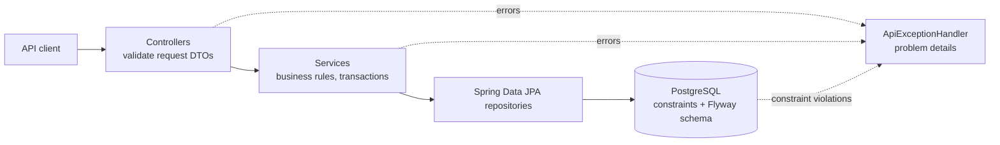

# Popcorn Palace API

A movie ticket booking backend built with Java 21 and Spring Boot 4. It manages a movie catalog, halls with real seat layouts, showtimes with per-category prices and seat bookings, and keeps its rules intact when requests race each other.

[Frontend](../frontend/README.md) · [Portfolio](https://antoniosifov.com) · [LinkedIn](https://www.linkedin.com/in/anton-iosifov/)

## Highlights

- Versioned REST API (`/api/v1`) with request/response DTOs, pagination and an allow-list for sorting
- Halls with row-by-row seat layouts, and a seat map per showtime with prices and availability
- Interactive API documentation generated from the code (Swagger UI, OpenAPI 3.1)
- Database schema owned by Flyway migrations that carry existing data forward; Hibernate only validates it
- Business rules enforced by database constraints, so they hold under concurrency
- Uniform error responses in the RFC 9457 "problem details" format with machine-readable codes
- 92 automated tests, most of them calling the API over HTTP against a real PostgreSQL

## Architecture

The code is organized by feature. Each feature package holds its controller, service, repository, entity and DTOs; `common` holds what they share.



```text
src/main/java/com/antoniosifov/popcornpalace/
├── movie/       # catalog
├── hall/        # halls and their seats
├── showtime/    # scheduling, prices per seat category
├── booking/     # seat booking, seat map
└── common/      # error handling, pagination, configuration
src/main/resources/db/migration/   # Flyway SQL migrations
```

Packages depend on each other in one direction only: `booking` → `showtime` → `hall`, `movie`.

## Technology

| Area | Technologies |
| --- | --- |
| Runtime | Java 21, Spring Boot 4.1 |
| API | Spring Web MVC, Bean Validation, springdoc-openapi |
| Persistence | Spring Data JPA, Hibernate 7, PostgreSQL 17, Flyway |
| Testing | JUnit 5, MockMvc, Testcontainers (PostgreSQL), AssertJ |
| Tooling | Maven Wrapper, Docker, Docker Compose, GitHub Actions, Lombok |

## API

Base URL: `http://localhost:8080/api/v1`. Interactive documentation: http://localhost:8080/swagger-ui.html (OpenAPI JSON at `/v3/api-docs`).

| Method | Endpoint | Purpose | Success |
| --- | --- | --- | --- |
| `GET` | `/movies` | List movies (paginated) | `200` |
| `GET` | `/movies/{id}` | Get a movie | `200` |
| `POST` | `/movies` | Add a movie | `201` + `Location` |
| `PUT` | `/movies/{id}` | Replace a movie | `200` |
| `DELETE` | `/movies/{id}` | Delete a movie | `204` |
| `GET` | `/halls` | List halls (paginated) | `200` |
| `GET` | `/halls/{id}` | Get a hall with its row-by-row layout | `200` |
| `POST` | `/halls` | Create a hall and its seats | `201` + `Location` |
| `DELETE` | `/halls/{id}` | Delete a hall and its seats | `204` |
| `GET` | `/showtimes` | List showtimes (paginated, optional `movieId` filter) | `200` |
| `GET` | `/showtimes/{id}` | Get a showtime | `200` |
| `POST` | `/showtimes` | Schedule a showtime | `201` + `Location` |
| `PUT` | `/showtimes/{id}` | Replace a showtime | `200` |
| `DELETE` | `/showtimes/{id}` | Delete a showtime | `204` |
| `GET` | `/showtimes/{id}/seats` | Seat map: every seat with price and availability | `200` |
| `POST` | `/bookings` | Book a seat | `201` + `Location` |
| `GET` | `/bookings/{id}` | Get a booking | `200` |

### Request bodies

Movie:

```json
{
  "title": "Interstellar",
  "genre": "Science Fiction",
  "durationMinutes": 169,
  "rating": 8.7,
  "releaseYear": 2014
}
```

Hall. The layout is given as blocks of identical rows, from the screen to the back; rows are numbered across blocks. This example creates rows 1–8 with 12 standard seats and rows 9–10 with 10 VIP seats. A layout cannot be changed after creation, because bookings point at individual seats.

```json
{
  "name": "Hall 1",
  "sections": [
    { "rows": 8, "seatsPerRow": 12, "category": "STANDARD" },
    { "rows": 2, "seatsPerRow": 10, "category": "VIP" }
  ]
}
```

Showtime. Times are ISO-8601 instants; any UTC offset is accepted and responses are in UTC. Every seat category used in the hall needs a price.

```json
{
  "movieId": 1,
  "hallId": 1,
  "startTime": "2030-01-15T18:00:00Z",
  "endTime": "2030-01-15T20:49:00Z",
  "prices": { "STANDARD": 14.50, "VIP": 22.00 }
}
```

Booking. The seat id comes from the showtime's seat map.

```json
{
  "showtimeId": 1,
  "seatId": 101,
  "userId": "84438967-f68f-4fa0-b620-0f08217e76af"
}
```

The response says where the seat is and what was paid; the price is a copy, so changing the showtime's prices later does not rewrite past bookings:

```json
{
  "id": "f2fc3714-ea45-4679-ba32-bba5019b91ba",
  "showtimeId": 1,
  "seatId": 101,
  "row": 9,
  "seatNumber": 5,
  "category": "VIP",
  "price": 22.00,
  "userId": "84438967-f68f-4fa0-b620-0f08217e76af",
  "createdAt": "2030-01-10T12:00:00.000Z"
}
```

### Seat map

`GET /showtimes/{id}/seats` returns everything a client needs to draw the hall and let a customer pick a seat (shortened):

```json
{
  "showtimeId": 1,
  "hallId": 1,
  "hallName": "Hall 1",
  "totalSeats": 116,
  "availableSeats": 115,
  "rows": [
    {
      "row": 9,
      "seats": [
        { "seatId": 100, "number": 4, "category": "VIP", "price": 22.00, "status": "AVAILABLE" },
        { "seatId": 101, "number": 5, "category": "VIP", "price": 22.00, "status": "BOOKED" }
      ]
    }
  ]
}
```

### Pagination and sorting

List endpoints take `page` (zero-based), `size` (default 20, capped at 100) and `sort` (`field,asc|desc`).

```text
GET /api/v1/movies?page=0&size=20&sort=releaseYear,desc
```

```json
{
  "content": [{ "id": 1, "title": "Interstellar", "genre": "Science Fiction", "durationMinutes": 169, "rating": 8.7, "releaseYear": 2014 }],
  "page": 0,
  "size": 20,
  "totalElements": 1,
  "totalPages": 1
}
```

Sorting is limited to an allow-list per resource (movies: `id`, `title`, `genre`, `durationMinutes`, `rating`, `releaseYear`; halls: `id`, `name`, `rowCount`, `seatCount`; showtimes: `id`, `startTime`, `endTime`). Any other field returns `400 INVALID_SORT`.

## Errors

Every error is an `application/problem+json` response ([RFC 9457](https://www.rfc-editor.org/rfc/rfc9457)) with a stable `code` that clients can branch on:

```json
{
  "title": "Conflict",
  "status": 409,
  "detail": "Row 9 seat 5 is already booked for this showtime",
  "instance": "/api/v1/bookings",
  "code": "SEAT_ALREADY_BOOKED"
}
```

Validation failures list every rejected field:

```json
{
  "title": "Bad Request",
  "status": 400,
  "detail": "Request validation failed",
  "instance": "/api/v1/movies",
  "code": "VALIDATION_FAILED",
  "errors": [
    { "field": "durationMinutes", "message": "must be greater than 0" },
    { "field": "title", "message": "must not be blank" }
  ]
}
```

| Status | Code | When |
| --- | --- | --- |
| `400` | `VALIDATION_FAILED` | A request field is missing or invalid |
| `400` | `MALFORMED_REQUEST` | The body is missing or is not valid JSON |
| `400` | `INVALID_SORT` | Sorting by a field outside the allow-list |
| `400` | `HALL_TOO_LARGE` | A hall layout over 60 rows or 1000 seats |
| `400` | `SHOWTIME_PRICE_MISSING` | No price for a seat category the hall uses |
| `400` | `SEAT_NOT_IN_HALL` | Booking a seat that is not in the showtime's hall |
| `404` | `MOVIE_NOT_FOUND`, `HALL_NOT_FOUND`, `SHOWTIME_NOT_FOUND`, `SEAT_NOT_FOUND`, `BOOKING_NOT_FOUND` | The resource does not exist |
| `409` | `MOVIE_TITLE_TAKEN`, `HALL_NAME_TAKEN` | The name is already in use |
| `409` | `MOVIE_HAS_SHOWTIMES`, `HALL_HAS_SHOWTIMES` | Deleting a movie or hall that still has showtimes |
| `409` | `SHOWTIME_OVERLAP` | The showtime overlaps another one in the same hall |
| `409` | `SHOWTIME_HAS_BOOKINGS` | Deleting a showtime with bookings, or moving it to another hall |
| `409` | `SHOWTIME_ALREADY_STARTED` | Booking a showtime that has already started |
| `409` | `SEAT_ALREADY_BOOKED` | The seat is already booked for this showtime |

Errors raised by the framework (unknown path, unsupported method or media type) use the same format, with the HTTP status name as the code, for example `NOT_FOUND`.

## Business rules and where they are enforced

Request validation gives early, precise errors. The database constraint is what guarantees the rule, including when two requests arrive at the same moment.

| Rule | Request / service | Database |
| --- | --- | --- |
| Movie fields valid; titles unique | `MovieRequest`, service check | `CHECK` constraints, `uq_movies_title` |
| Hall names unique; layout within size limits | `HallRequest`, service check | `uq_halls_name` |
| A seat position exists once per hall | — | `uq_seats_position` |
| Showtime ends after it starts; prices not negative | `ShowtimeRequest` | `CHECK` constraints |
| Every seat category of the hall has a price | service check | — |
| Showtimes in one hall do not overlap (back-to-back is allowed) | service query | exclusion constraint `ex_showtimes_hall_time` |
| A seat is booked at most once per showtime | service check | `uq_bookings_showtime_seat` |
| A booked seat belongs to the showtime's hall | service check | composite foreign keys `fk_bookings_showtime`, `fk_bookings_seat` |
| Movies and halls with showtimes, and showtimes with bookings, cannot be deleted | — | foreign keys |

Constraint violations are translated to API errors by constraint name in one place (`ConstraintErrors`).

### Double booking

Checking "is the seat free?" and then inserting is not enough: two simultaneous requests can both see the seat as free. The unique constraint `uq_bookings_showtime_seat` is the real guard. The losing insert fails in the database and the API reports it as `409 SEAT_ALREADY_BOOKED`.

`BookingConcurrencyTest` fires 30 simultaneous requests at one seat and asserts that exactly one gets `201` and one row exists. With the constraint removed, the same test produced 10 bookings for the seat.

### Overlapping showtimes

The same problem exists for scheduling: two managers can pass the overlap check at the same moment. The rule therefore lives in PostgreSQL as an exclusion constraint over the hall and the half-open time range:

```sql
EXCLUDE USING gist (hall_id WITH =, tstzrange(start_time, end_time, '[)') WITH &&)
```

`ShowtimeConcurrencyTest` fires 20 simultaneous requests for the same hall and time and asserts that exactly one showtime is created. With the constraint removed, the same test created 10 overlapping showtimes.

### A seat that is not in the hall

`bookings` repeats the hall id and has two composite foreign keys, `(showtime_id, hall_id)` and `(seat_id, hall_id)`. Together they make a booking for a seat from another hall impossible to store, and they stop a showtime that already has bookings from being moved to another hall.

## Migrations

| Version | What it does |
| --- | --- |
| `V1` | Movies, showtimes, bookings |
| `V2` | Halls, seats, prices per seat category, exclusion constraint for overlaps; bookings point at seats |

`V2` migrates existing data instead of dropping it: each distinct theater name becomes a hall with 15 × 20 seats (the first API accepted seat numbers 1–300), the old showtime price becomes its standard price, and each booking is pointed at its seat and keeps the price it was sold for. `SchemaMigrationTest` builds a database at `V1`, fills it, migrates and checks the result.

## Run locally

### Requirements

- Docker (Docker Desktop on Windows/macOS)
- Java 21, only when running the API outside Docker

### Everything in Docker

From the repository root:

```bash
docker compose up --build
```

The API listens on http://localhost:8080 and Flyway creates the schema on first start.

### API from your IDE

Start only the database, from the repository root:

```bash
docker compose up -d db
```

Then, from `backend/`:

macOS/Linux:

```bash
./mvnw spring-boot:run
```

Windows:

```powershell
.\mvnw.cmd spring-boot:run
```

Connection settings come from `DB_URL`, `DB_USERNAME` and `DB_PASSWORD` and default to the compose database. Browser origins allowed by CORS are set with `CORS_ALLOWED_ORIGIN_PATTERNS` (default: any `localhost` port).

## Tests

macOS/Linux:

```bash
./mvnw verify
```

Windows:

```powershell
.\mvnw.cmd verify
```

Docker must be running: the API tests start a disposable PostgreSQL container through Testcontainers and call the application over HTTP, so they exercise JSON mapping, validation, transactions, migrations and constraints together. Rules that need no database (text normalization, request validation, sort allow-list) have plain unit tests.

Current suite: **92 tests passing**.
