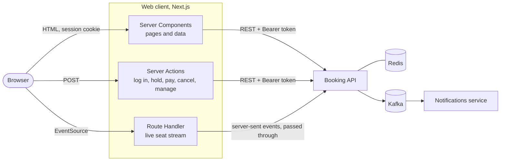
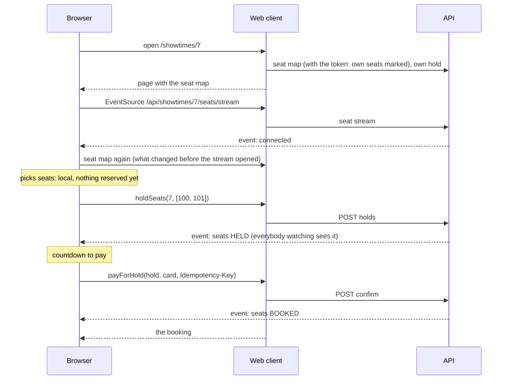

# Popcorn Palace web client

The part of Popcorn Palace a customer opens in a browser: the programme, a live seat map for every showtime, checkout, the customer's bookings, and a small back office for whoever runs the cinema. Next.js 16 (App Router) and TypeScript, on top of the [booking API](../backend/README.md).

[Booking API](../backend/README.md) · [Notifications service](../notifications/README.md) · [Portfolio](https://antoniosifov.com) · [LinkedIn](https://www.linkedin.com/in/anton-iosifov/)

## Highlights

- A first screen that is tonight's film: its still, its title, the next showing, and one press to the seats
- The programme for the next seven days, on the cinema's clock whatever time zone the visitor or the server is in
- A page for every film: poster, description, director and cast, the trailer played on the page, every showtime, and the rest of the programme
- A seat map that is live: seats other customers hold, release or buy change on screen as it happens, without a reload
- Checkout in two steps that match the API: hold the seats for ten minutes with a countdown, then pay
- Payments that cannot charge twice: one idempotency key per attempt, kept across retries and page reloads
- The browser never sees the access token or the API: the session is an `HttpOnly` cookie and every call to the API is made by the server
- Every error says what happened in the customer's words and carries the trace id of the request, the one the API logs and traces by
- A back office for administrators: movies, halls (with a preview of the layout as it is designed) and showtimes
- Pages are prerendered shells that fill in at request time; the build needs no running API
- A shared link is previewed with a picture: the site's own card, or the still of the film the link is to
- Unit and component tests for the rules, and end-to-end tests that drive a real browser against the whole stack, down to the ticket email

## How it fits together



The browser talks to one origin only. That decision carries most of the others:

| Decision                                                   | Why                                                                                                                                                                                                                                                                                         |
| ---------------------------------------------------------- | ------------------------------------------------------------------------------------------------------------------------------------------------------------------------------------------------------------------------------------------------------------------------------------------- |
| **The server calls the API, the browser never does**       | The access token stays in an `HttpOnly`, `SameSite=Lax` cookie that scripts in the page cannot read, so a cross-site script cannot steal it. No address of the API is compiled into the bundle, and the API needs no cross-origin rules for this client.                                    |
| **Reads are Server Components, writes are Server Actions** | A page fetches what it shows on the server and streams it into its shell. Logging in, holding seats, paying, cancelling and managing the catalog are actions: plain `POST` endpoints that check their input and their caller themselves, and report a refusal as data, not as an exception. |
| **The live stream is passed through, not reinvented**      | `GET /api/showtimes/{id}/seats/stream` is a Route Handler that pipes the API's server-sent events to the browser byte for byte. When the browser goes away the request is aborted, which closes the connection to the API too.                                                              |
| **The API is the authority, the pages are a courtesy**     | The request proxy and the layouts keep visitors away from pages they cannot use, but nothing relies on that: every action and every read is checked by the API with the token.                                                                                                              |
| **Errors are the API's, in the customer's words**          | The API answers with RFC 9457 problems and stable codes. [`lib/errors.ts`](src/lib/errors.ts) maps codes to sentences, keeps the rejected fields for the form, the seats that were lost, and the `traceId`, which is shown as a reference.                                                  |

## The live seat map and the checkout

This is the screen the product exists for, and where the browser has real work to do. All of its rules are pure functions ([`lib/seatmap.ts`](src/lib/seatmap.ts)) and one reducer ([`lib/booking-state.ts`](src/lib/booking-state.ts)), so they are tested without a browser.



- **Subscribe, then load.** The stream does not replay what happened before a browser subscribed. So the page loads the seat map once more whenever the stream opens: the first time, to cover the gap since the page was rendered, and after every reconnect, to cover the time it was away.
- **Whose hold is it.** The stream is public and the same for everybody; a held seat is recognised as the customer's own by the id of their hold, whichever arrives first, the event or the answer to their request.
- **Somebody was faster.** A picked seat that another customer holds first leaves the order with a sentence saying which seat. If the race is lost at the last moment, the API's refusal names the seats and only those are dropped.
- **The server decides when a hold is over.** The countdown is this device's clock. When it reaches zero the page asks the server instead of declaring the hold dead.
- **One key per purchase attempt.** The browser makes up an `Idempotency-Key` when Pay is pressed and keeps it (in `sessionStorage`, so a reload does not lose it) until the attempt is settled. A lost connection or "still processing" repeats the same key and cannot charge twice; a decline or a provider failure ends the attempt, and the next press gets a new key, because the API replays the recorded answer for a used one.
- **Giving seats back does not wait.** "Change seats" frees them on screen at once and tells the server in the background; the seats stay picked so the choice can be adjusted.

The payment provider is a sandbox: no card number is typed or sent. Each test card stands for one outcome (approved, approved after a delay, declined for insufficient funds, declined as expired, provider failure), so every path through a checkout can be tried by hand.

## Time

A showtime is a moment; a cinema announces it on its own clock. The API speaks in UTC instants and this client converts at the edge, with `Intl` only ([`lib/time.ts`](src/lib/time.ts)):

- every time on screen is shown in `CINEMA_TIME_ZONE`, by the server and the browser alike, so a visitor abroad sees the time on the door;
- "today" and "tomorrow" are days of that zone, also at 23:30 UTC;
- what an administrator types into a date and time field is read on that clock, including the nights the clocks change.

## Rendering

Next.js runs with Cache Components: each page is prerendered as a static shell (the frame, the navigation, the skeleton of the content), and everything that comes from the API streams into it at request time, behind `<Suspense>`. Nothing from the API is cached: seats, holds and bookings change by the second.

Two consequences worth knowing:

- `next build` needs no API and no database. The Docker image is built in CI with nothing else running.
- A page's HTTP status is sent with the shell. A booking that is not the visitor's, or the back office for a customer, is answered with the "Nothing here" page; the status of the response is `200`, as it is for any page whose "not found" is discovered while streaming.

## Design

A cinema at night. The first screen is tonight's film: its still fills the screen, its title is set along the bottom edge in a serif (Sentient) at the size of a film title, and the next showing is one press from the seats. Below it the week is a strip of seven days, and every film of the chosen day is a row: the poster, what it is about, and its showtimes as the controls they are.

One dark theme. Surfaces are told apart by lightness alone, without borders or shadows on cards. One hue, the brass of a foyer, is kept for the primary action and for what is the customer's own: their seats and what they cost. Prices and halls are set on a printed sheet with a ticket's scalloped edge, the one light surface of the site. Sentences meant to be read are set in the serif; everything that is operated or scanned (times, prices, forms, the seat map, the back office) is in Inter with tabular figures.

Pictures come from TMDB's servers in the size a screen needs: a TMDB picture's address contains its width, so `srcset` is built from the widths TMDB serves ([`lib/artwork.ts`](src/lib/artwork.ts)), and only `https` addresses are ever put on a page. A film without artwork (the built-in catalogue has none) gets a drawn title card, a monogram of its first two letters, and a film without a still gets a first screen made of type alone. The trailer plays over the page it was asked for on; nothing is requested from YouTube until a visitor asks for the trailer, and then from the address that sets no cookies before play. Underneath it is a plain link, which is what a browser without scripts, or a trailer that is not on YouTube, gets.

Motion is quiet, with one loud moment: the still of the first screen opens like a shutter. Parts of a page rise into place the first time they are scrolled to, once ([`components/reveals.tsx`](src/components/reveals.tsx)): an animation held on its first frame, so nothing is written into the markup and the page is whole without scripts. A visitor who asked for less motion gets none.

The hall is drawn as itself: the screen as an arc, rows centred as they are in the room, VIP seats with a headrest. Seats never shrink below 24 px, the smallest target a finger hits reliably; a hall too wide for a phone at that size scrolls sideways inside its own frame.

## Run it

### With everything else, in Docker

From the repository root:

```sh
docker compose up --build
```

Open http://localhost:3000. The stack starts with a demo programme (three halls, eight movies, a week of showtimes), so there is something to book right away. Register an account, pick a showtime, hold seats and pay with a test card; the ticket email appears in Mailpit at http://localhost:8025. To use the back office, log in as the development administrator (`admin@popcorn.local` / `admin-dev-password`).

### On its own, against a running API

Requirements: Node.js 22 and the API on http://localhost:8080 (see the [root README](../README.md)).

```sh
npm install
npm run dev
```

Open http://localhost:3000. Settings go in `.env.local`:

| Variable                | Default                      | Meaning                                                                                                                                        |
| ----------------------- | ---------------------------- | ---------------------------------------------------------------------------------------------------------------------------------------------- |
| `API_URL`               | `http://localhost:8080`      | Where the API is, as seen from this server                                                                                                     |
| `CINEMA_TIME_ZONE`      | `UTC`                        | The IANA zone whose clock all times are shown on, for example `Europe/Berlin`                                                                  |
| `CURRENCY`              | `USD`                        | ISO 4217 code of the prices (the API's `PAYMENT_CURRENCY`)                                                                                     |
| `SESSION_COOKIE_SECURE` | `true` in a production build | Send the session cookie over HTTPS only. Set to `false` only where the site is served over plain HTTP on purpose, as the local Docker stack is |
| `SITE_URL`              | the address of the request   | The address the site is reached at, for the picture a shared link is previewed with. Set on a server; elsewhere the request says it            |
| `PORT`                  | `3000`                       | The port of the server                                                                                                                         |

All of them are read by the server when a request comes in. None is compiled into the bundle, so one image runs in any environment.

## Tests

```sh
npm test            # unit and component tests (Vitest, Testing Library)
npm run e2e         # end-to-end tests (Playwright); the Docker stack must be running
npm run lint
npm run typecheck
npm run format:check
```

**Unit and component tests** (104) cover the rules without a browser or a server:

| What                                                                              | Where                                                                      |
| --------------------------------------------------------------------------------- | -------------------------------------------------------------------------- |
| Times on the cinema's clock, days that are 23 hours long, times that do not exist | [`lib/time.test.ts`](src/lib/time.test.ts)                                 |
| Seat events, picking, the limit of eight, sums in whole cents                     | [`lib/seatmap.test.ts`](src/lib/seatmap.test.ts)                           |
| Every step from picking to paying, including events that overtake answers         | [`lib/booking-state.test.ts`](src/lib/booking-state.test.ts)               |
| The API client: tokens, problems, an unreachable API                              | [`lib/api/client.test.ts`](src/lib/api/client.test.ts)                     |
| Error messages, idempotency keys, safe redirects, booking status                  | [`lib/errors.test.ts`](src/lib/errors.test.ts)                             |
| Pictures at every width, addresses that are refused, the trailer's id             | [`lib/artwork.test.ts`](src/lib/artwork.test.ts)                           |
| The address the site gives for itself, the description in a link's preview        | [`lib/site.test.ts`](src/lib/site.test.ts)                                 |
| The seat picker as a customer uses it, with the stream and the server replaced    | [`components/seat-booking.test.tsx`](src/components/seat-booking.test.tsx) |

**End-to-end tests** (13) drive Chromium against the stack that `docker compose` starts, and run in CI on every pull request:

- a visitor opens a film's page from the programme and goes on from it to another film;
- a customer registers, picks seats, pays, sees the ticket, and the email arrives (browser to API to Kafka to the notifications service to the mail catcher);
- two browsers on one showtime: a seat one customer holds, releases and buys changes in the other's window without a reload;
- a picked seat taken by somebody else leaves the order;
- a declined card keeps the hold and another card completes the booking;
- cancelling refunds, emails, and puts the seat back on sale;
- a hold survives leaving the page;
- pages that need an account send a visitor to log in and back; the session cookie is `HttpOnly`; the back office does not exist for a customer;
- an administrator adds a movie, schedules it, is refused an overlapping showtime with the form left as typed, and removes both.

By default the tests expect the stack on its usual ports. `E2E_BASE_URL`, `E2E_MAILPIT_URL`, `E2E_ADMIN_EMAIL` and `E2E_ADMIN_PASSWORD` change that, and `PLAYWRIGHT_CHANNEL=chrome` uses an installed Chrome instead of downloading a browser. The tests register a new customer each, so raise the API's `AUTH_RATE_LIMIT` when running them repeatedly.

## Project structure

```text
src/
├── proxy.ts              a first check before pages that need an account
├── app/                  routes: the programme, movies, showtimes, bookings, login, admin
│   └── api/              route handlers: the live seat stream, the seat map, health
├── actions/              Server Actions: auth, checkout, admin
├── components/           the seat map and checkout, posters and stills, the trailer, forms, navigation
└── lib/
    ├── api/              the API client and the shapes it returns
    ├── booking-state.ts  the reducer behind the seat picker
    ├── seatmap.ts        seat events, picking, totals
    ├── time.ts           instants and the cinema's clock
    ├── artwork.ts        pictures at the size a screen needs, and which addresses are let onto a page
    └── errors.ts         API problems as sentences
e2e/                      Playwright tests
```
