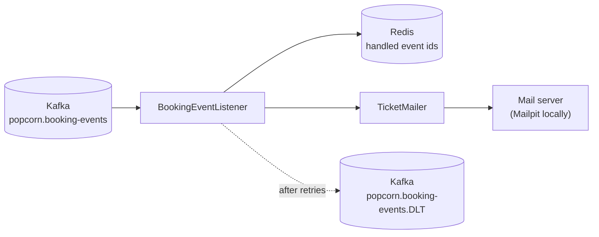

# Popcorn Palace Notifications

A small service that emails tickets. It reads booking events that the [API](../backend/README.md) publishes to Kafka and sends a ticket email when a booking is confirmed and a cancellation email when it is cancelled.

It shares nothing with the API but the events: no database, no HTTP calls in either direction. Either service can be down, restarted or redeployed without the other noticing; events published while this service is down are delivered when it comes back.

## How it works



| Concern | What the service does |
| --- | --- |
| Duplicates | Kafka delivers every event at least once. Handled event ids are kept in Redis for a week; a redelivered event is skipped. The email is sent first and the id recorded second, so a crash in between can at worst repeat an email, never lose one. |
| Temporary failures (mail server down) | The event is retried three times, two seconds apart. |
| Permanent failures (not JSON, required fields missing) | No retries: the message is copied unchanged to the dead-letter topic `popcorn.booking-events.DLT` and skipped, so it cannot block the events behind it. The same happens to an event that still fails after its retries. Parked events are not recorded as handled, so they can be replayed. |
| Unknown event types | Skipped. The API may publish new kinds of events at any time. |
| Changes to the event format | The service reads only the fields it needs and ignores the rest, so the API can add fields without this service changing. |
| Watching it | Port 8081 (inside the stack only) serves `/actuator/health` with `kafka`, `redis` and `mail` components, readiness (`kafka`, `redis`) and liveness probes, and `/actuator/prometheus`: emails sent by type (`popcorn_notifications_emails_total`), duplicates ignored, events parked in the dead-letter topic (`popcorn_notifications_dead_letters_total`), and the Kafka consumer's lag. |
| Tracing | Each event is handled inside the trace the API started for the booking request (the `traceparent` header the outbox relay puts on the message). The consumer span, the email and the log lines carry that trace id, and the email repeats it in an `X-Popcorn-Trace-Id` header, so a customer's email and the request that caused it can be matched from either end. Spans go to Jaeger in the local stack. |

`BookingEvent` is this service's own view of the event, not a class shared with the API.

## Run locally

From the repository root, `docker compose up --build` starts this service together with the API, PostgreSQL, Redis, Kafka and Mailpit. Every email ends up in Mailpit at http://localhost:8025; nothing is delivered to real mailboxes.

To run it from the IDE, start the infrastructure only (`docker compose up db redis kafka mailpit`) and run `NotificationsApplication`; the defaults point at the ports compose publishes.

| Variable | Purpose | Default |
| --- | --- | --- |
| `KAFKA_BOOTSTRAP_SERVERS` | Kafka | `localhost:29092` |
| `REDIS_HOST`, `REDIS_PORT` | Redis, for handled event ids | `localhost:6379` |
| `MAIL_HOST`, `MAIL_PORT` | SMTP server | `localhost:1025` |
| `MAIL_USERNAME`, `MAIL_PASSWORD` | The account at a real mail service; the mail catcher of the local stack needs none | empty |
| `MAIL_SECURE` | `true` for a real mail service: log in, and send nothing, the password included, unless the connection has been encrypted first (STARTTLS, port 587) | `false` |
| `MAIL_FROM` | Sender shown on the emails | `Popcorn Palace <tickets@popcorn-palace.local>` |
| `NOTIFICATION_TIME_ZONE` | Showtimes are printed in this time zone | `UTC` |
| `MANAGEMENT_PORT` | Health and metrics; keep it inside the network | `8081` |
| `OTLP_TRACES_ENDPOINT` | Where spans are sent (OTLP over HTTP) | `http://localhost:4318/v1/traces` |
| `TRACING_EXPORT_ENABLED` | Set to `false` where nothing collects spans | `true` |
| `LOG_FORMAT` | Empty for readable logs, `ecs` for one JSON object per line | empty |

## Tests

```bash
./mvnw verify
```

Docker must be running: the tests start Kafka and Redis through Testcontainers and an in-memory SMTP server (GreenMail), publish events to the real topic and wait for the emails to arrive. They cover the ticket and cancellation emails, duplicate delivery, unknown event types, malformed messages going to the dead-letter topic, a mail server that stays down, the trace id travelling from the Kafka message into the email, the health and metrics endpoints, and the settings of a real mail service: with `MAIL_SECURE` on, nothing is sent to a server that offers no encryption.
